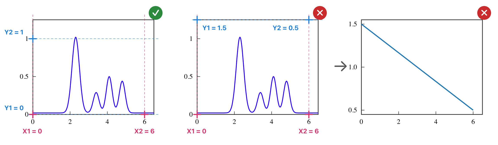
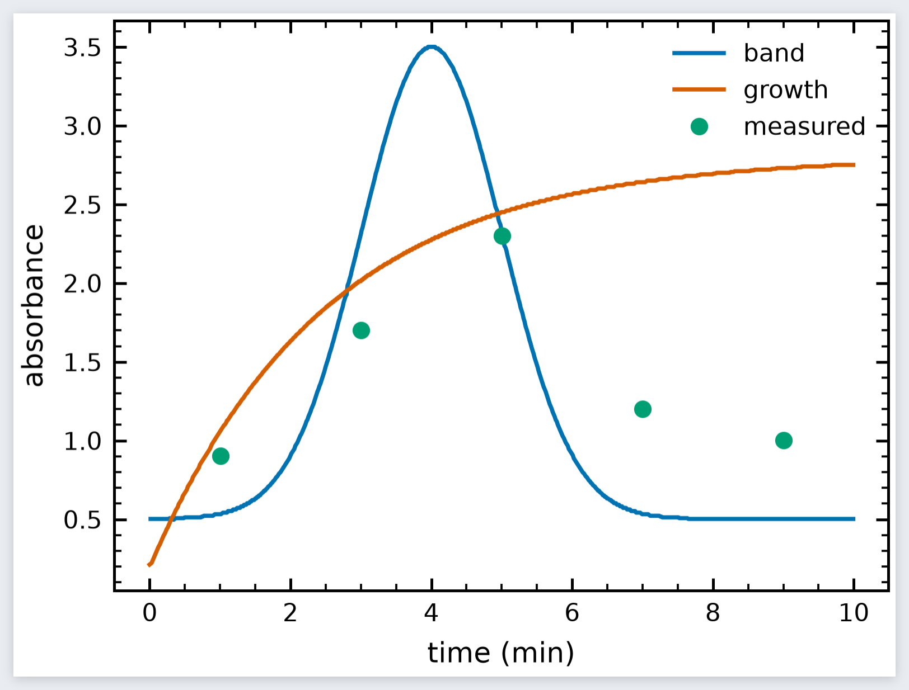
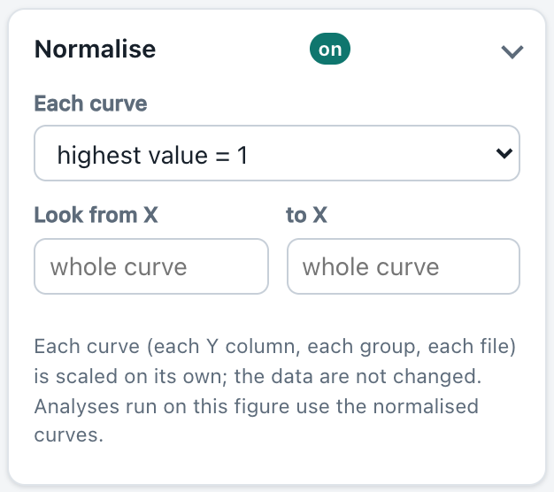
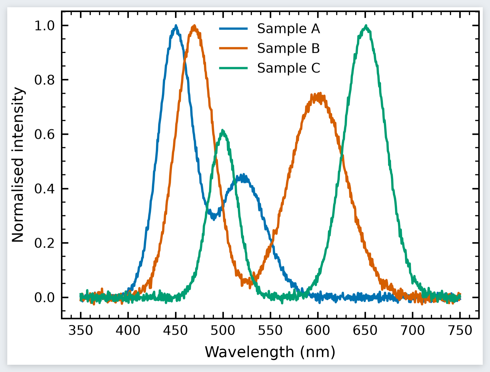

# π-plotter — Manuale d’uso

*Dr. T. Francese*

π-plotter trasforma quasi ogni file di dati in una figura di qualità editoriale e la analizza con moduli Python open source (NumPy, SciPy, statsmodels, Matplotlib…), tutto nel browser e tutto sul tuo computer. Questo manuale segue l’ordine in cui si lavora: **aprire i dati → scegliere cosa disegnare → dare lo stile alla figura → analizzare (fit, picchi, statistica…) → esportare**. Ogni passaggio ha un’immagine presa dal programma stesso.

> **Suggerimento:** il manuale è sempre raggiungibile dal pulsante **Manuale** nella barra in alto. Si apre in una nuova scheda, così lo tieni accanto al programma, e segue la lingua del programma (**EN / IT** in alto; in alto a destra nel manuale puoi cambiarla).

> **Nota sulle immagini:** sono le stesse del manuale inglese e mostrano l’interfaccia **in inglese**. Nel testo i nomi di pulsanti e menu sono quelli **italiani** dell’interfaccia italiana; dove può servire, il nome inglese che vedi nell’immagine è dato tra parentesi, per esempio **Apri file** (*Open files*).

## 1. Prima di cominciare

### 1.1 Avviare π-plotter

1. Installa una volta **Python 3.10 o successivo** ([python.org/downloads](https://www.python.org/downloads/)).
2. Avvia il programma:
  - **macOS**: doppio clic su `start_piplotter.command` (la prima volta: clic destro › **Apri** › **Apri**).
  - **Windows**: doppio clic su `start_piplotter.bat`.
  - **Linux** o qualunque sistema: `python3 start_piplotter.py`.
3. Si apre una finestra del terminale e il browser mostra π-plotter su `http://127.0.0.1:8770`. **Tieni aperta la finestra del terminale** mentre lavori; `Ctrl+C` al suo interno chiude il programma.
4. Solo la prima volta, la pagina propone di installare NumPy, pandas e Matplotlib (circa 80 MB). Premi **Installa e avvia**; una barra mostra l’avanzamento. Vanno nell’ambiente privato di π-plotter (la cartella `.venv`), mai nel Python di sistema.

Tutto gira sul tuo computer: il servizio ascolta solo su `127.0.0.1` e i tuoi file non ne escono. Solo l’installazione dei moduli (da PyPI) usa internet.

### 1.2 La finestra principale


La finestra ha tre colonne:

| Numero | Area | A cosa serve |
|---|---|---|
| 1 | **Dati** (a sinistra) | Aprire file, dati di esempio, elenco dei file caricati, opzioni di importazione. |
| 2 | **Variabili** (a sinistra) | Quale colonna è X, quali sono Y, colonne di errore, raggruppamento, come si combinano più file. |
| 3 | **Tipi di grafico** (in alto al centro) | Una barra di 27 tipi di grafico; il programma ne suggerisce uno (★). |
| 4 | **Figura / Tabella dati** (al centro) | La figura com’è quando la esporti; una seconda scheda mostra i dati. Accanto compaiono le schede dei risultati delle analisi. |
| 5 | **Analisi** (a destra) | Scegli un’analisi, imposta i parametri, eseguila, leggi i numeri. |
| 6 | **Esporta** (a destra) | Formato, risoluzione, nome del file. |
| 7 | **Dimensioni e impaginazione, Stile e colori, Serie, Testi e caratteri, Assi e tacche, Legenda** (a destra) | Tutto ciò che cambia l’aspetto della figura. |

Nella barra in alto: **Nuovo** inizia una nuova analisi (chiude dati, figura e risultati ma tiene il tuo stile), il pulsante con la scopa **svuota la cache** (vedi *Ripartire da zero* nella sezione 6), **Moduli** gestisce i moduli Python, **Manuale** apre questo manuale, **ⓘ** mostra licenze e cosa citare, **EN / IT** cambia lingua e il pulsante sole/luna passa dalla modalità chiara a quella scura.

## 2. Passo 1 — Apri i dati

### 2.1 Aprire un file

Premi **Apri file** (*Open files*) nel riquadro *Dati*, oppure **trascina uno o più file in un punto qualsiasi della pagina**.

 e il riquadro Variabili (in basso). Il file caricato compare nell’elenco con le sue dimensioni: 801 righe × 4 colonne.")

π-plotter legge CSV, TSV, TXT e DAT (separatore, virgola decimale, intestazione, righe di commento e codifica del testo vengono riconosciuti da soli), Excel (`.xlsx`, `.xls`), LibreOffice `.ods`, JSON, Parquet, Feather, ORC, HDF5, NetCDF, MATLAB `.mat`, NumPy `.npy/.npz`, FITS, SPSS, Stata, SAS, XML, tabelle HTML, SQLite, **spettri JCAMP-DX** (`.jdx`, `.dx`), **immagini** (PNG, JPEG, TIFF… — aperte come matrici, vedi 5.9) e file ZIP o compressi (`.gz`, `.bz2`, `.xz`).

* Se un formato richiede un modulo facoltativo (per esempio `openpyxl` per Excel), una piccola finestra propone di installarlo, con una barra di avanzamento. Premi **Installa**; a installazione finita il file si può aprire.
* Un file con più tabelle (fogli di Excel, dataset HDF5, tabelle SQLite…) mostra sotto gli esempi un elenco **Tabella / foglio / dataset**: scegli quella che vuoi.
* L’elenco **File caricati** mostra ogni file con righe × colonne. Clicca un nome per mostrare quel file; clicca **✕** per toglierlo.

> **Suggerimento — non hai dati sotto mano?** I pulsanti **Esempi** (*Spettri, Spettro IR, Cinetica, Gruppi, Superficie, Nuvola di punti*) caricano piccoli insiemi di dati sintetici. Tutte le immagini di questo manuale li usano, così puoi ripetere ogni passaggio esattamente.

### 2.2 Quando il file non viene letto bene

Apri **Opzioni di importazione** (*Import options*; compaiono sotto gli esempi per i file di testo).


1. Cambia **Separatore** (virgola, punto e virgola, tab, barra, spazi) e **Separatore decimale** se le colonne sono sbagliate.
2. Imposta **Riga di intestazione** (o *nessuna*) e **Righe da saltare** se il file comincia con delle note.
3. Premi **Applica**.

Se vengono trovati numeri con il separatore delle migliaia (per esempio `1,234.5`), π-plotter chiede se **Convertire in numeri**; altrimenti quelle righe mancherebbero nei grafici numerici.

### 2.3 Guarda i dati

La scheda **Tabella dati** (*Data table*) mostra le prime righe con il tipo di ogni colonna (`float64`, `int64`, testo, data…). Controlla qui che i numeri siano numeri.


La tabella si può **modificare** come un foglio di calcolo: clicca una cella e scrivi (Invio scende, Tab va a destra, Esc annulla), oppure **incolla** un blocco copiato da Excel, LibreOffice o un file di testo (Ctrl/⌘+V sulla cella scelta; righe e colonne si aggiungono da sole). **＋ Riga** e **＋ Colonna** aggiungono spazio, un clic sui numeri di riga sceglie le righe da **eliminare**, un doppio clic sul nome di una colonna la **rinomina**, ✕ nella sua intestazione la elimina. **ƒ Formula di colonna…** riempie una colonna a partire dalle altre, come *Imposta valori colonna* in altri programmi: `sqrt(A) * 2`, `col("tempo (s)") / 60`, `A - mean(A)`, `i` (il numero di riga). La virgola decimale è capita (`1,5`). **↶ Annulla** (Ctrl/⌘+Z) torna indietro di una modifica alla volta. Il grafico e le analisi usano subito ogni modifica; il file originale non viene mai cambiato.

**＋ Nuova tabella (scrivi o incolla i dati)**, sotto *Apri file*, parte da una tabella vuota con le colonne A e B.

**⤓ CSV** e **⤓ Excel**, nella barra della tabella, salvano l’intera tabella in un file: CSV (UTF-8, letto da qualsiasi programma, accenti compresi) o Excel `.xlsx` (il modulo *openpyxl*, installato al primo uso). Le righe escluse restano fuori.

**Escludere punti** (valori anomali, una misura sbagliata): scegli le righe cliccando i loro numeri e premi **Escludi n righe**, oppure premi **✕ Escludi punti dal grafico…** e clicca i punti stessi (di nuovo per riportarne uno; Esc termina). Per lasciar fuori molti punti in una volta — tutto quello oltre X = 3000, per esempio — premi **✕ Escludi un intervallo…** e scegli a cosa si riferisce l’intervallo: **Numeri di riga** (quelli a sinistra della tabella), **Valori di X** del grafico, **Valori di Y** (una colonna Y, quando ce ne sono più di una) o una **Condizione** scritta. Non sono la stessa cosa: la riga 3000 è la tremillesima riga, X = 3000 è dove la colonna X vale 3000, e le due differiscono appena la X non va 1, 2, 3… una riga dopo l’altra o le righe non sono in ordine di X. Scrivi **Da** e/o **A** (estremi compresi; uno lasciato vuoto vuol dire nessun limite da quel lato, quindi solo Da 3000 prende tutto da 3000 in su) e spunta *Escludi invece ciò che sta fuori dall’intervallo* per tenere solo l’intervallo. Una condizione si scrive come una formula di colonna — `col1 > 3000`, `1000 < col1 < 2000`, `col1 < 500 or col1 > 4000`, `row > 3000` per i numeri di riga, `col("il suo nome")` per una colonna con spazi; scegliere *Condizione* dopo un intervallo parte dall’intervallo già scritto. Prima di escludere qualcosa, la finestra mostra la condizione che ne risulta e quante righe prende, da quale riga a quale (e quante sono già escluse); **Escludi** resta spento finché non uscirebbe nessuna riga nuova. Ogni riga presa viene esclusa, in tutte le pagine della tabella; una riga con una cella vuota in quelle colonne resta com’è. Le righe escluse restano nella tabella, barrate; il grafico le mostra come croci grigie (*esclusi* nella legenda); ogni analisi le lascia fuori. **Includi n righe** le riporta.

**Le analisi seguono i dati**: dopo ogni modifica della tabella (un valore, un blocco incollato, punti esclusi, Annulla), le analisi disegnate sulle copie del grafico, i grafici dei risultati e i numeri nel riquadro sono rieseguiti da soli con le stesse impostazioni, mantenendo il loro stile. Un’analisi di un risultato (un fit dei picchi trovati da una ricerca dei picchi) segue a sua volta il suo risultato. Finché non sono state rieseguite sulla nuova tabella, le schede delle copie mostrano ⟳ e il riquadro dice che i numeri si stanno ricalcolando. Se un’analisi non si può eseguire sulla tabella cambiata — per esempio la colonna da cui è stata fatta è stata rinominata o eliminata — non prende mai un’altra colonna di nascosto: la sua scheda mostra **!** e il riquadro dice che i suoi numeri vengono da una versione precedente della tabella, con **Riesegui** (per quando la colonna c’è di nuovo); **Annulla** li rende di nuovo attuali.

### 2.4 Più file insieme

Apri (o trascina) più file insieme e vengono disegnati **nello stesso grafico**, con un colore e una voce di legenda per file. La sezione **Combina file** (*Combine files*) del riquadro *Variabili* permette di scegliere quali file, colonne e colonne di errore includere, oppure di passare a **Un pannello per file** (*One panel per file*).


Le analisi lavorano sul file evidenziato in **File caricati**. Per analizzare un’altra curva dello stesso grafico, clicca il suo file: la figura resta com’è (stesso tipo, stile, curve e colori) e quel file diventa quello analizzato.

Le analisi di file diversi vanno sulla **stessa copia** del grafico: per esempio esegui *Distribuzione gaussiana di una colonna* sul primo file, clicca il secondo file ed eseguila di nuovo — la copia mostra i due istogrammi con le due gaussiane e i loro valori.

, (b): pronto per una figura a più pannelli da rivista.")

### 2.5 Tabelle molto larghe

Le tabelle con migliaia di colonne (per esempio serie di spettri) vanno bene: ogni elenco di colonne ha **Tutte / Nessuna**, un filtro che accetta anche un intervallo di nomi numerici (`19600-19840`) o di posizioni (`#1-500`), e Maiusc+clic spunta un intero blocco. La mappa di calore disegna tutte le colonne; la matrice di correlazione ne accetta fino a 2000.

### 2.6 L’immagine di un grafico: rileggerne i dati

Resta solo l’immagine di un grafico — una figura di un articolo, una scansione, una schermata — e servono i suoi numeri? Apri l’immagine (PNG, JPEG, TIFF…) come qualsiasi file e premi **⌖ Leggi i dati di questo grafico…** sotto l’elenco dei file. (L’immagine compare prima come mappa di calore: π-plotter apre ogni immagine come una matrice di livelli di grigio, che è ciò che serve per una micrografia o l’immagine di un rivelatore. Per un grafico quella mappa è solo il passaggio: il digitalizzatore mostra l’immagine nei suoi colori.)

, la curva letta dal suo colore (puntini magenta) e i marcatori trovati (cerchi).")

#### Calibrare gli assi: X1, X2, Y1, Y2

Un’immagine è fatta solo di pixel: π-plotter non sa quali numeri portino i suoi assi. Glielo insegni con quattro punti, due per asse, ciascuno con il numero stampato in quel punto del grafico; da questi ogni pixel diventa una coppia (x, y).

La regola è una sola: **ogni punto dà il valore di un solo asse.**

* **X1 e X2** sono due tacche dell’asse **orizzontale**, con i numeri sotto di esso — affiancate, il più lontane possibile (per esempio la prima e l’ultima tacca numerata).
* **Y1 e Y2** sono due tacche dell’asse **verticale**, con i numeri accanto a esso — una sopra l’altra, il più lontane possibile.
* **Non** sono gli angoli del grafico, né punti (x, y) della curva: di un punto X conta solo la posizione da sinistra a destra, di un punto Y solo l’altezza.
* X1 e Y1 possono essere lo stesso pixel — l’origine, quando entrambi gli assi partono da 0.



Passo per passo, per un grafico come quello qui sopra:

1. Ingrandisci con la rotella sulla tacca **0** sotto l’asse X e clicca dove la tacca incontra l’asse: è **X1**; scrivi **0**.
2. Clicca la tacca **6** dello stesso asse: **X2**; scrivi **6**.
3. Clicca la tacca **0** dell’asse Y: **Y1**; scrivi **0** (qui lo stesso posto di X1).
4. Clicca la tacca **1** dell’asse Y: **Y2**; scrivi **1**.
5. Controlla: porta il puntatore su una tacca che non hai usato, o sulla cima di un picco di cui conosci il valore — la **x = … y = …** mostrata sotto l’immagine deve dire ciò che dice il grafico.

La finestra aiuta lungo la strada: il suggerimento sotto l’immagine dice quale punto cliccare e dove; per ogni punto una linea tratteggiata mostra dove l’immagine ha quel valore (verticale per X, orizzontale per Y), così due linee Y sulla stessa riga mostrano subito che i punti Y sono stati cliccati affiancati. Usa tacche con un numero stampato, non il bordo della cornice: spesso la cornice finisce su un valore senza numero (1,25 nell’immagine qui sopra), e un valore indovinato sposta tutti i punti letti. Più i due punti di un asse sono lontani, più piccolo è l’errore di un clic.

| Cosa è andato storto | Cosa vedi | Cosa fare |
|---|---|---|
| Y1 e Y2 affiancati (gli angoli in alto) | «I due punti dell’asse Y sono affiancati» | cliccali uno sopra l’altro, sull’asse Y |
| X1 e X2 uno sopra l’altro | «I due punti dell’asse X sono uno sopra l’altro» | cliccali affiancati, sull’asse X |
| lo stesso numero scritto per i due punti | «… vogliono due valori diversi» | due tacche con numeri diversi |
| un asse logaritmico letto come lineare | valori giusti sulle tacche, sbagliati fra l’una e l’altra | spunta **X / Y logaritmica**, con tacche come 0,1 e 1000 |
| un valore indovinato in un punto senza numero | tutti i valori sbagliati dello stesso fattore | tacche con un numero stampato |

#### Le tre fasi: assi, curve, tabella

1. **Assi.** Clicca X1, X2, Y1 e Y2 come descritto sopra — sono chiesti in quest’ordine, ciascuno con il suo suggerimento — e scrivi i loro valori; spunta **X / Y logaritmica** per assi logaritmici. La rotella ingrandisce l’immagine, **✋ Sposta** (o il tasto centrale, o la barra spaziatrice tenuta premuta) la trascina, e la lente mostra proprio il pixel che un clic prende. Un’immagine scansionata un po’ storta si legge correttamente: un valore viene dalla posizione del punto lungo il suo asse.
2. **Curve.** Per ogni curva (**＋ Curva** ne aggiunge una; dai a ciascuna un nome) scegli come leggerla:
   * **una linea, dal suo colore** — premi **Prendi il suo colore dall’immagine** e clicca la curva: ogni pixel di quel colore diventa un punto, uno per colonna di pixel, seguendo la curva dove ne incrocia un’altra;
   * **marcatori (dispersione), dal loro colore** — il centro di ogni simbolo;
   * **punto per punto, cliccando** — clicca ogni punto (un clic su un punto lo toglie): per curve nere, tratteggiate o nascoste da altre.
   **Tolleranza del colore** allarga o restringe i colori presi (le linee sfumate ne vogliono un po’); **Disegna un riquadro attorno** tiene solo quella parte dell’immagine — per lasciare fuori la legenda, le etichette o un’altra curva dello stesso colore. I punti letti compaiono subito sull’immagine.
3. **Tabella.** Dai un nome alle colonne X e Y e premi **Crea la tabella e tracciala**: la tabella si aggiunge ai file caricati (con una colonna *curve* quando le curve sono più d’una) e il grafico viene disegnato da essa — linee per le curve, marcatori per i punti — pronto per essere analizzato, normalizzato, adattato o esportato. **⤓ CSV** e **⤓ Excel** la salvano subito.



La tabella ricorda come è stata letta: in un progetto viene rifatta dall’immagine, e **⌖ Leggi i dati di questo grafico…**, con la tabella sullo schermo, riapre l’immagine con i suoi assi e le sue curve, per cambiarli. La precisione dei valori dipende dall’immagine: circa un pixel, quindi una figura larga 600 pixel dà circa lo 0,2 % dell’asse — controlla sempre qualche punto con l’originale.

## 3. Passo 2 — Scegli le variabili e il tipo di grafico

### 3.1 Variabili

, Asse Y secondario, Raggruppa per (colore).")

* **Asse X** — la colonna sull’asse orizzontale.
* **Asse Y (una o più)** — spunta ogni colonna da disegnare. Ognuna diventa una serie con il suo colore.
* **Asse Y secondario** — colonne disegnate rispetto a un secondo asse a destra (per esempio temperatura e concentrazione nello stesso grafico).
* **Raggruppa per (colore)** — una colonna di testo i cui valori dividono i dati in gruppi colorati.
* **Errore X / Errore Y** — compaiono per i tipi di grafico che possono disegnare barre d’errore; scegli la colonna con le incertezze (le colonne chiamate `err`, `std`, `sigma`, `errore`… vengono riconosciute da sole).

### 3.2 Tipi di grafico


La barra offre **27 tipi di grafico**: linea, dispersione, gradini, area, barre d’errore, fit (con equazione e R²), stelo, polare, barre, barre orizzontali, box, violino, strip, swarm, torta, istogramma, densità, ECDF, mappa di calore, contorni, esagoni, istogramma 2D, matrice di correlazione, grafico a coppie e tre tipi **3D** (superficie, dispersione 3D, cascata).

Il programma guarda il tipo delle colonne e **suggerisce** il grafico giusto: una ★ segna la prima scelta e i pulsanti **Suggeriti** (*Suggested*) sotto la figura ne propongono qualche altro. Una serie temporale diventa un grafico a linee, una nuvola di punti una dispersione (o esagoni se i punti sono molti), le categorie diventano barre o box, le griglie X-Y-Z contorni o mappe di calore.

> **Suggerimento:** se la figura sembra sbagliata, controlla prima il riquadro **Variabili**: di solito è spuntata una colonna che non dovrebbe esserlo (la colonna X, un contatore, una colonna di errore).

## 4. Passo 3 — Dai alla figura l’aspetto giusto

Tutti i controlli sono nella colonna di destra. La figura viene ridisegnata subito; è sempre disegnata alla sua **dimensione fisica reale**, quindi ciò che vedi è ciò che stamperà la rivista.

### 4.1 Dimensioni, stile, colori, serie


* **Dimensioni e impaginazione** (*Size & layout*) — scegli un **Formato rivista** (Nature, Science, ACS, Elsevier, RSC, APS, IEEE, pagina di tesi, diapositiva, pannello da poster…) oppure scrivi **Larghezza** e **Altezza** in mm, cm o pollici. Lo sfondo trasparente è una spunta.
* **Stile e colori** (*Style & colours*) — lo **Stile** (pubblicazione pulita, griglia bianca, ggplot, Science / Nature-like / IEEE-like da SciencePlots…), la **Tavolozza colori** (Okabe–Ito e Tol sono sicure per i daltonici) e, per mappe di calore e superfici, la **Mappa di colore**. Qui si impostano per tutte le serie spessore della linea, dimensione del marcatore, opacità, tipo di linea e marcatore.

, etichetta, tipo di linea, marcatore e spessore. *ripristina* torna ai valori automatici.")

* **Serie** — cambia colore, etichetta in legenda, tipo di linea, marcatore e spessore di **una** serie. I colori di questo riquadro sono esattamente quelli della figura.

#### Normalizza — ogni curva a 1 (spettri)





Spettri misurati con intensità diverse (concentrazione, cammino ottico, guadagno del rivelatore) si confrontano per la loro **forma**: in **Normalizza** (*Normalise*) scegli come scalare ogni curva.

* **valore massimo = 1** — ogni curva divisa per il suo massimo, la scelta abituale per spettri di assorbimento, emissione, Raman e diffrattogrammi XRD;
* **massimo |valore| = 1** — per curve con bande in su e in giù (CD, derivate, spettri differenza): la banda più grande, qualunque sia il segno, diventa ±1;
* **da 0 a 1** — il punto più basso diventa 0 e il più alto 1 (min–max): toglie anche uno spostamento costante;
* **area = 1** — ogni curva divisa per la sua area (regola dei trapezi lungo X), per confrontare forme di banda e distribuzioni;
* **valore a una X = 1** — ogni curva divisa per il suo valore alla X che scrivi (interpolato), per esempio a una banda di standard interno o a un punto isosbestico.

*Cerca da X … a X* limita a un intervallo la ricerca del massimo, del minimo o dell’area: la banda che vuoi a 1 anche quando altrove una banda del solvente è più alta (quella allora supera 1). Ogni colonna Y, ogni gruppo della colonna dei colori e ogni altro file del grafico è scalato **per conto suo**; le colonne d’errore sono scalate con la loro curva e i punti esclusi con lo stesso fattore. L’etichetta Y diventa «*colonna* (normalizzata)» o «Intensità normalizzata», se non ne hai scritta una. **I dati non cambiano**: la tabella, le esportazioni dei dati e i file sul disco conservano i valori misurati, mentre il grafico, le sue esportazioni (anche lo script Python, che ripete la normalizzazione, e l’HTML interattivo) e le analisi eseguite su di esso usano le curve normalizzate — altezze dei picchi, aree e ampiezze dei fit sono allora quelle delle curve normalizzate, come dice il pannello dei risultati. Cambiare la normalizzazione su una copia con analisi le riesegue. Una curva che non si può normalizzare (nessun massimo positivo, una curva piatta, una X fuori dalla curva) è indicata in un messaggio. La normalizzazione vale per linee, dispersione, gradini, aree, steli, barre d’errore, regressioni, grafici polari e a cascata.

> **Nota:** i nomi delle riviste nei formati descrivono solo la larghezza delle colonne. Sono marchi dei rispettivi titolari, che non sono affiliati a π-plotter.

### 4.2 Testi, assi, legenda


* **Testi e caratteri** (*Text & fonts*) — titolo ed etichette degli assi (di norma i nomi delle colonne), il carattere e le dimensioni **in punti**. Le formule vanno tra segni di dollaro: `$\alpha$`, `$10^{-3}$`, `$\mu$m`, `$H_2O$`.
* **Assi e tacche** (*Axes & ticks*) — scale lineare, logaritmica o symlog; limiti X/Y (vuoto = automatico); griglia; direzione delle tacche, tacche secondarie e speculari; cornice; notazione scientifica; **Inverti X** (per i numeri d’onda, che si leggono dall’alto verso il basso).
* **Legenda** — mostrata in automatico, sempre o mai; posizione (anche fuori dagli assi); colonne; titolo; cornice.

#### Linee e bande di riferimento

In **Linee e bande di riferimento** premi **＋ Linea** e clicca sul grafico dove va — una linea verticale a quella x (scegli *orizzontale (a una y)* per un livello) — oppure **＋ Banda** e clicca i suoi due estremi per ombreggiare un intervallo (una finestra di integrazione, una zona esclusa, un intervallo di valori normali). Ognuna si può poi scrivere esattamente (*a*, *fino a*), con un’**etichetta**, un colore e un tipo di linea, nascondere o togliere; **Sul grafico** la riposiziona con un clic. Le etichette stanno al bordo degli assi e, come ogni testo, si trascinano o si riscrivono con un doppio clic. Linee e bande si salvano con il grafico e nei progetti; su un asse di date si accettano date (`2024-05-01`).

#### Riquadro ingrandito

In **Riquadro ingrandito** premi **Scegli la regione sul grafico** e trascina un rettangolo sulla parte da ingrandire (un piccolo picco, l’inizio di una curva): compare ingrandita in un riquadro dentro gli assi, con le stesse serie e gli stessi colori, le curve delle analisi e le linee di riferimento, e sottili linee che la collegano alla regione. Cambia la regione esattamente (*X da / a*, *Y da / a* — Y vuota segue i dati), l’angolo (*Posizione*) e la *Dimensione*; togli la spunta a *Mostra il riquadro* per nasconderlo. Una legenda automatica si sposta dall’altra parte. Funziona con linee, dispersione, gradini, barre d’errore, aree, stem, regressioni e istogrammi.

#### Interruzioni d’asse

Un’interruzione toglie da un asse un tratto vuoto o poco interessante — lo spazio tra un gruppo di barre basse e una molto alta, o i mesi senza misure in una serie temporale. In **Assi e tacche** premi **＋ Interruzione X sul grafico** (o **＋ Interruzione Y sul grafico**) e trascina sul tratto da togliere, oppure scrivilo in *Interruzioni X* / *Interruzioni Y*: `12 – 95`, più tratti separati da `;` (`12 – 95; 200 – 300`), le date come `2024-02-05 – 2024-05-28`. Il tratto si riduce a uno stretto spazio segnato // sulla cornice; i due lati mantengono la stessa scala e hanno le loro tacche. Una curva non viene unita attraverso un’interruzione di x; attraverso un’interruzione di y prosegue (un picco alto mantiene i suoi fianchi). Le curve delle analisi, le linee di riferimento, il riquadro ingrandito, i riquadri di valori e i punti cliccati sul grafico seguono l’asse interrotto. Le interruzioni funzionano su assi lineari (non logaritmici), con linee, dispersione, gradini, barre d’errore, aree, istogrammi e sull’asse dei valori di barre e box plot; l’esportazione HTML interattiva mostra l’asse intero. Svuota il campo per togliere le interruzioni. **Lati X / Lati Y (lunghezze)** danno a ogni lato delle interruzioni una lunghezza propria invece della stessa scala: `1:3` rende il secondo lato lungo tre volte il primo (un numero per lato, da sinistra o dal basso), `uguali` dà a ogni lato la stessa lunghezza — un gruppo di valori piccoli ha allora tanto spazio quanto l’unico valore enorme sopra l’interruzione. Tacche, curve, punti cliccati e riquadro ingrandito seguono.

#### Più figure in una — composizione

Premi **＋ Composizione** accanto alle schede delle figure: una nuova scheda mette affiancate in un’unica figura la figura e le sue copie (con analisi, grafici dei risultati), con lettere (a), (b)… — ogni pannello mantiene i propri dati, tipo, curve, analisi, riquadro ingrandito e linee di riferimento. In **Composizione di figure** spunta le figure da includere (l’ordine delle spunte è l’ordine dei pannelli), imposta le **Colonne** e le lettere. Accanto a ogni figura spuntata, **↔** e **↕** scelgono quante colonne e righe della griglia occupa: uno spettro largo in alto con due pannelli più piccoli sotto, uno alto accanto a due. I pannelli riempiono la griglia riga per riga nel loro ordine, così le lettere si leggono in ordine; dimensioni, caratteri e un titolo complessivo si impostano come per ogni figura, e le lettere si trascinano o si riscrivono. Cambia una figura nella sua scheda e la composizione la segue. Si esporta in PNG, TIFF, JPG, PDF, SVG o EPS e si salva nei progetti.

### 4.3 Zoom, sposta e riscrivi direttamente sulla figura

* **Zoom**: trascina un riquadro sulla figura, o gira la rotella del mouse. Gli assi vengono ridisegnati per il nuovo intervallo, non solo ingranditi. Maiusc+rotella o un riquadro sottile ingrandisce un solo asse. **↶ Zoom precedente** (*Previous zoom*) torna indietro di un passo, **⤢ Figura intera** mostra tutto (lo stesso fa il doppio clic sul grafico).


* **Sposta i testi**: trascina il titolo, un’etichetta degli assi, la legenda, l’etichetta della barra dei colori, l’etichetta di una fetta di torta o di un picco in un altro posto.
* **Riscrivi i testi**: doppio clic su un testo, scrivi il nuovo (formule tra `$…$`) e premi Invio. *Testo originale* e *Posizione originale* ripristinano quelli automatici.
* **Leggi i valori**: su ogni figura con assi (non 3D), i valori sotto il mouse sono scritti in un piccolo riquadro accanto. I due pulsanti in basso a sinistra della figura scelgono come mirare: il **puntatore del mouse** (freccia) o un **mirino a ×** con linee guida attraverso gli assi. Un **clic** fissa un punto: su linee e dispersioni il punto dei dati più vicino, con colonna, riga e valori esatti; altrove il punto cliccato. **×** sul suo riquadro o **Esc** lo toglie. I riquadri sono messi dove non coprono testi, legenda e riquadri di valori della figura; la scelta tra puntatore e mirino resta in questo browser.

. I due pulsanti in basso a sinistra scelgono il puntatore o il mirino.")

Zoom, testi spostati e riscritti restano in ogni esportazione.

### 4.4 Figure tridimensionali

I tipi 3D sono la **superficie** z(x, y) (da una griglia regolare o da punti sparsi, anche solo reticolo), la **dispersione / linea 3D** e la **cascata** di spettri (una curva per colonna, alla profondità data dal nome della colonna, per esempio un tempo o una temperatura).


**Trascina la figura per ruotarla**: una copia leggera dei dati gira in modo fluido nella pagina; al rilascio gli angoli restano e la figura viene ridisegnata con Matplotlib. Il doppio clic torna alla vista predefinita. Gli angoli di vista e i limiti di Z sono anche nel riquadro *Assi e tacche*.

### 4.5 Modelli di stile

**Salva modello di stile** (nel riquadro *Esporta*) scrive tutte le impostazioni di stile in un piccolo file JSON; **Carica modello** le applica a un’altra figura. Serve a dare a un intero articolo lo stesso aspetto.

## 5. Passo 4 — Analizza i dati

### 5.1 Come funziona il riquadro Analisi

Il riquadro **Analisi** è in cima alla colonna di destra. Gli stessi cinque passi valgono per ogni analisi:

1. **Scegli l’analisi** dall’elenco.
2. **Imposta i parametri** (colonne, modello, limiti…). Le colonne sono proposte in base alle tue variabili.
3. Premi **Esegui l’analisi** (*Run analysis*).
4. **Leggi i risultati** sotto il pulsante: una tabella di riepilogo, tabelle dei parametri, frasi in linguaggio semplice e i **riferimenti da citare**. *Copia* e *CSV* esportano ogni tabella. **Da dove viene** (chiuso all’inizio) elenca i passi che hanno prodotto il risultato: il file (o l’esempio, o la tabella scritta a mano), le modifiche fatte a mano nella tabella (celle, formule, punti esclusi…), poi ogni analisi con i suoi parametri.
5. Guarda il risultato sulla figura con **Mostra su una copia del grafico** (*Show on a copy of the figure*), oppure apri un risultato con assi propri (autocorrelazione, spettro di potenza, grafico Q–Q…) con **Traccia il risultato** (*Plot the result*).


> **Nota:** **la figura originale non viene mai modificata.** Le curve delle analisi sono disegnate su una *copia*, in una scheda accanto a *Figura* (si chiude con **×**). Le analisi eseguite mentre una copia è aperta si aggiungono a quella copia, che ha il proprio stile e si esporta come ogni figura. **← Torna al grafico originale** riporta ai dati.

Le analisi sono raggruppate così:

| Gruppo | Analisi |
|---|---|
| **Ricette** | Distribuzione gaussiana di una colonna · Media di una serie temporale · Equilibratura di una simulazione · I gruppi sono diversi? · Relazione tra due variabili · Fit dei picchi · Cinetica di reazione |
| **Fit** | Fit di curve |
| **Serie temporali e correlazione** | Autocorrelazione (ACF / PACF) · Block averaging · Correlazione incrociata |
| **Statistica** | Statistica descrittiva · Test di normalità e grafico Q–Q · Confronto tra gruppi · Correlazione · Regressione lineare e ANOVA · Fit di distribuzioni |
| **Elaborazione dei segnali** | Smoothing e derivata · Spettro di potenza · Linea di base · Ricerca dei picchi · Assegnazione dei picchi IR · Integrale e area |

Le **Ricette** sono l’ingresso più facile: ognuna concatena più analisi, sceglie valori predefiniti sensati e risponde in parole semplici. Se non sei sicuro, parti da una ricetta.

**Suggerite per questo grafico**: sopra l’elenco, π-plotter propone le analisi adatte al grafico sullo schermo, dalla più adatta, e l’elenco comincia con loro (★). Un istogramma riceve la ricetta gaussiana e il fit di distribuzioni; uno spettro (x in nm, cm⁻¹, eV…) linea di base, picchi, fit dei picchi (e assegnazione IR per i cm⁻¹); un segnale che decade, la cinetica e un fit esponenziale; una serie nel tempo, la sua media con il vero errore, l’equilibratura e l’autocorrelazione; barre o box per gruppo, il confronto tra i gruppi; una nuvola di punti, la relazione tra le due variabili; tempi con eventi (0/1), le curve di sopravvivenza e la regressione di Cox; due categorie (x e colore), l’ANOVA a due vie e la tabella di contingenza; una matrice, anche i suoi spot; un segnale molto lungo, la decimazione. Passa sopra un suggerimento per vederne il motivo; sceglierlo imposta anche valori iniziali utili (es. Fit di curve dell’istogramma con una gaussiana).

Ogni analisi usa moduli open source consolidati (SciPy, statsmodels) e ti dà i **riferimenti da citare** insieme ai risultati.

> **Valori nel grafico, da qualsiasi analisi:** i fit scrivono da soli i loro valori in un riquadro; per ogni altro risultato (statistica descrittiva, test, picchi, aree, una serie…) premi **＋ Valori nel grafico…** sotto il risultato, spunta i numeri (una media arriva con il suo errore standard, es. *media = 0.240 ± 0.055*), cambia il testo se vuoi e premi **Aggiungi al grafico**. Il riquadro va sul grafico sullo schermo: trascinalo, fai doppio clic per riscriverlo, e in **Sovrapposizioni** cambiane testo o colore, nascondilo o toglilo. Si salva con il grafico e nei progetti.

### 5.2 Fit di una curva — esempio svolto (cinetica)

Obiettivo: adattare un decadimento alla concentrazione di un reagente e ottenere la vita media con il suo errore.

1. Premi **Esempi › Cinetica**. Nel riquadro *Variabili* tieni **Time (min)** come X e spunta solo **Concentration (mM)** come Y. Scegli il tipo di grafico **Barre errore** e, come **Errore Y**, **Std. dev. (mM)**.
2. In *Analisi* scegli **Fit di curve**.


3. Imposta **Errore Y (pesi, facoltativo)** su **Std. dev. (mM)**: i punti con errore maggiore contano di meno.
4. Scegli il **Modello**: esponenziale (anche doppio e stretched/KWW), potenza, gaussiana, lorentziana, Voigt, logistica, Hill, Michaelis–Menten, Arrhenius, seno, polinomi — oppure scrivi **la tua formula** in x, per esempio `a*exp(-x/tau) + c`. Qui: `y = A·exp(−x/τ) + C`.
5. Facoltativo: dai **Valori iniziali** (`tau=10, c=0`) e **Limiti** (`a=0..inf, tau=1..100`) se il fit non converge; scegli la **Banda d’errore della curva** (confidenza 95 % della curva, predizione, o nessuna); restringi l’intervallo con **Fit da x =** e **Fit fino a x =**.
6. Premi **Esegui l’analisi**.


Come leggerli:

* **R², R² corretto, RMSE, χ²_red** dicono quanto bene la curva descrive i dati (χ²_red vicino a 1 significa che la dispersione è in accordo con le barre d’errore che hai dato); **AIC** e **BIC** servono a confrontare modelli — più bassi sono, meglio è.
* **Parametri adattati** elenca valore, errore standard, intervallo di confidenza al 95 % ed errore relativo. Qui τ risulta vicino a 14 min, il valore usato per generare l’esempio.

7. Premi **Mostra su una copia del grafico** per disegnare la curva e la sua banda d’errore sopra i dati.

. La figura originale resta intatta.")

> **Suggerimento:** il *Fit di curve* adatta anche l’**istogramma di una colonna** (per esempio una gaussiana su una distribuzione di valori): usa **Dati da adattare** per scegliere l’istogramma della colonna (viene scelto da solo quando la figura è un istogramma) e, se vuoi, il numero di **Intervalli dell’istogramma**.

#### Più curve insieme — fit globale e riepilogo dei fit

Quando il grafico contiene **più curve** — più colonne Y, o altri file spuntati in *File caricati* — scegli **Fit globale di più curve** (viene suggerito appena c’è più di una curva). Un solo modello viene adattato a **tutte le curve del grafico insieme**:

* **Parametri condivisi** — scrivine i nomi, es. `tau`: hanno **un solo valore per tutte le curve** (una sola vita media per decadimenti misurati a più temperature), adattato su tutti i dati insieme, quindi con un errore più piccolo di quello di una curva sola. Gli altri parametri (qui A e C) restano **propri di ogni curva**.
* Un parametro può essere condiviso anche **solo da alcune curve**: `tau[1,2], tau[3-5]` dà un τ alle curve 1–2 e un altro alle curve 3–5 (i numeri della tabella di riepilogo). I **parametri fissi** (`C=0`) restano a quel valore per ogni curva.
* I **vincoli** legano un parametro ad altri: `A2 = 2*A1` (con il modello a due esponenziali) rende A₂ il doppio di A₁ su ogni curva; `A[2] = 2*A[1]` rende l’A della curva 2 il doppio di quella della curva 1. Più vincoli si separano con `;`, e a destra si possono usare numeri, + − × ÷, potenze ed exp, log, sqrt… Un parametro vincolato è **calcolato, non adattato** (non è insieme condiviso o fisso, e i limiti non valgono per lui); il suo errore nel riepilogo viene dagli errori dei parametri da cui è fatto (propagati attraverso la loro covarianza).
* **Pesi:** quando ogni curva ha una colonna di **errore Y** nel grafico, i suoi punti contano come 1/σ² e il risultato dà χ²_red; scegli *nessuno* per pesare tutti i punti allo stesso modo.
* Lascia il campo **vuoto** per un **fit in serie**: ogni curva adattata da sola, con gli stessi numeri che darebbe il *Fit di curve* una per una.
* La tabella **Riepilogo dei fit** ha **una riga per curva**: file (e colonna), N, ogni parametro con il suo errore, R² e RMSE. *Grafica il risultato* disegna un parametro in funzione del numero della curva; la tabella si esporta come qualunque dato.
* Ogni curva riceve la sua linea adattata su una copia del grafico, e i valori condivisi sono scritti in un riquadro nel grafico (opzione *Scrivi i valori condivisi nel grafico*). I punti esclusi restano fuori dal fit.

#### La stessa analisi su ogni file — in serie

Con **più file caricati**, il riquadro Analisi ha un pulsante **Esegui su tutti i n file** accanto a *Esegui l’analisi*: l’analisi viene eseguita, **con le impostazioni del modulo**, su ogni file di *File caricati*, e dà **una tabella con una riga per file** — es. τ ± σ(τ), R², RMSE dello stesso fit esponenziale su venti misure.

* Le colonne **seguono ogni file**: X e Y scelte per il file sullo schermo diventano X e Y proprie di ciascun file (come le disegna il grafico), quindi file con nomi di colonna diversi funzionano insieme.
* **Scegli i file** (sotto i pulsanti) elenca i file caricati: togli la spunta a quelli da lasciare fuori, e il pulsante diventa **Esegui sui n file scelti**.
* **Esegui su una cartella…** la esegue su ogni file di una cartella che scegli, **senza caricarli**: solo i file con la stessa estensione di quello sullo schermo (esclusi i file nascosti e i file `._` di macOS), nell’ordine dei loro nomi (`run 2` prima di `run 10`), ciascuno letto con le colonne del grafico. Non vengono aggiunti a *File caricati*; la tabella li ricorda, quindi un progetto salvato dopo li contiene. Funziona anche con un solo file caricato.
* Un file su cui l’analisi non può essere eseguita (troppo pochi punti, una colonna mancante) è elencato in **File su cui non riesce**, con il motivo; gli altri vengono eseguiti comunque.
* La tabella si apre come **grafico a sé** — il primo numero in funzione del numero del file, con le barre d’errore — e si può modificare, esportare e salvare in un progetto come qualunque dato.

### 5.3 Cinetica di reazione in un clic

La ricetta **Cinetica di reazione (ordine, k, t½)** adatta leggi di ordine zero, uno e due agli stessi dati, le confronta con l’AIC e dà l’ordine migliore, la costante di velocità *k* e il tempo di dimezzamento con gli errori. Scegli il tempo come X, la concentrazione come Y (e la sua colonna di errore come *Errore di y*) e premi **Esegui l’analisi**.


 su una copia della figura.")

> **Su un istogramma:** con un istogramma di una colonna sullo schermo, *Linea di base*, *Ricerca dei picchi*, *Fit dei picchi*, *Integrale* e *Filtro* lavorano sull’istogramma come disegnato — i suoi intervalli, in conteggi o densità — invece che sui valori della colonna uno dopo l’altro. Così i punti di ancoraggio cliccati sul grafico (*Scegli sulla figura*) sono nelle unità del grafico (valore, conteggio o densità), i picchi sono le mode della distribuzione e l’area di una densità vale 1. Il risultato lo dice nella prima riga.

### 5.4 Spettri e cromatogrammi: linea di base → picchi → fit dei picchi → area

Per ogni segnale con picchi (UV-Vis, IR, Raman, XRD, cromatogrammi…) lavora in quest’ordine: **prima la linea di base, poi l’analisi**.

#### Passo 1 — Linea di base

Scegli **Linea di base**. Di base il programma disegna **una retta sotto il segnale**; puoi anche cliccare tu i punti di ancoraggio, oppure scegliere un metodo che segue un fondo curvo.

, e il verso dei picchi riconosciuto dal segnale.")

* **Automatica: retta sotto il segnale (o polinomio)** — il valore predefinito. La retta è adattata ai punti che stanno sulla linea di base; i punti più alti della retta di oltre tre volte il rumore (i picchi) non la sollevano (Mazet et al., 2005). **Forma** dice quanto può curvarsi: **0** un livello piatto, costante; **1** una retta (il valore predefinito); **2–6** un polinomio leggermente curvo per fondi che si piegano. Dove il segnale non ha picchi, il segnale corretto è piatto.
* **Punti di ancoraggio (clic sulla figura)**: premi **Scegli sulla figura** (*Pick on the figure*) e clicca dove il segnale poggia sulla sua linea di base, tra e attorno ai picchi; premi **Esc** o **Fatto** quando hai finito (**Togli l’ultimo** e **Cancella** correggono gli errori). **Ogni clic tiene la sua x e la sua y**, quindi il punto resta esattamente dove l’hai cliccato (la casella di testo mostra `x y`, un punto per riga). Un punto scritto con la **sola x** prende l’altezza del segnale lì. Scegli se i punti sono uniti da segmenti di retta o da una curva liscia.
* **Metodi automatici che seguono i fondi curvi**: *arPLS*, *minimi quadrati asimmetrici*, *SNIP* o *elastico*. Cambia **Rigidità** (più bassa segue di più il segnale) o **Asimmetria** se la linea sale dentro picchi larghi.
* **I picchi sono rivolti**: in su (assorbanza, conteggi, intensità) o in giù (trasmittanza, avvallamenti). Con **riconoscilo dal segnale** il programma decide dalla forma dei dati: per uno spettro in trasmittanza come l’esempio la linea di base viene disegnata **sopra** gli avvallamenti, lungo il bordo superiore dello spettro.

Altre due scelte decidono ciò che ottieni:

* **Correzione** — come la linea di base viene tolta dal segnale. *Automatica* **divide** uno spettro in trasmittanza (o riflettanza) per la sua linea di base, T / T₀ × 100, così lo spettro corretto resta in % con la linea di base al 100 % e le bande profonde come prima; per ogni altro segnale la linea di base viene **sottratta**, quindi sta a 0. Puoi anche forzare *sottrai* o *dividi*.
* **Mostra anche lo spettro prima della correzione, con la sua linea di base** — spenta di default.

Premi **Esegui l’analisi**, poi il pulsante verde sotto i risultati:

* Con l’opzione **spenta** (il valore predefinito) il pulsante è **Traccia il risultato**: una nuova scheda mostra **solo lo spettro corretto**, con la linea di base corretta come linea punteggiata (al 100 % o a 0). La figura originale non viene toccata.

 tra le bande, che mantengono la loro profondità.")

* Con l’opzione **accesa** il pulsante è **Mostra su una copia del grafico**: la copia mostra lo spettro prima della correzione, la sua linea di base (tratteggiata) e i punti di ancoraggio, e lo spettro corretto, così li puoi confrontare. *Traccia il risultato* dà le stesse curve in una figura a parte.

 e lo spettro corretto insieme.")

> **Nota:** lo spettro corretto è un nuovo insieme di dati: nella sua scheda puoi dargli uno stile, esportarlo o analizzarlo ancora. La sua **Tabella dati** contiene x, il segnale originale, la linea di base e il segnale corretto.

I risultati dicono anche in che verso puntano i picchi, quale correzione è stata usata e quanti punti stanno dalla parte sbagliata della linea di base; oltre il 5 % il programma avverte che la linea taglia il segnale lì.

*Ricerca dei picchi*, *Fit dei picchi* e *Integrale* propongono poi la stessa linea di base già selezionata, così altezze, larghezze e aree sono misurate **sopra di essa**.

#### Passo 2 — Ricerca dei picchi

Scegli **Ricerca dei picchi**. Trova i picchi per **prominenza** (usa **Prominenza minima** per ignorare il rumore; vuoto significa il 5 % dell’intervallo) e riporta posizione, altezza, FWHM e area sopra la linea di base. Usa **Solo da x / fino a x** per restringere l’intervallo, o **Cerca i minimi** per gli avvallamenti. La **posizione è scritta sopra ogni picco**; le etichette affollate si spostano di lato con una linea di richiamo.


#### Passo 3 — Fit dei picchi

La ricetta **Fit dei picchi (spettri, cromatogrammi)** trova i picchi e li **adatta tutti insieme** con forme gaussiane o lorentziane (**Forma dei picchi**): centro, altezza, FWHM e area di ogni picco, con gli errori. Ogni picco resta dentro la sua regione. Come **Linea di base** puoi scegliere anche una retta o una costante adattate insieme ai picchi.


, i singoli picchi (punteggiati) e le posizioni dei picchi sopra di essi.")

> **Nota:** gli errori sulle aree ignorano la correlazione tra altezza e larghezza (sono approssimati), e gli errori sono condizionati alla linea di base, che viene sottratta e non adattata.

#### Passo 4 — Integrale

**Integrale e area** dà l’area sotto la curva tra due valori di x (**Da x / A x**) e l’integrale cumulativo, volendo sopra la stessa linea di base.

### 5.5 Assegnazione dei picchi IR

Su uno spettro nel medio infrarosso (assorbanza o trasmittanza; numero d’onda in cm⁻¹, o lunghezza d’onda in µm o nm) l’**Assegnazione dei picchi IR** trova i picchi ed elenca per ognuno i **gruppi candidati** da una tabella di circa 110 bande caratteristiche: gruppi organici, e anioni inorganici e minerali (carbonati, solfati, silicati, ossalati…) per la scienza dei materiali e la conservazione.

1. Premi **Esempi › Spettro IR**, o apri il tuo spettro.
2. Scegli **Assegnazione dei picchi IR**. Il programma riconosce da solo trasmittanza o assorbanza e l’unità (**Lo spettro è**, **Unità di x** = *riconoscila*); cambiali se serve.
3. **Confronta con** sceglie la tabella: *tutta la tabella*, *gruppi organici* o *anioni inorganici e minerali*; **Gruppi organici con** è *solo C, H, O, N* a meno che tu scelga *anche S, P, Si, alogeni*.
4. Premi **Esegui l’analisi**, poi **Mostra su una copia del grafico**.


.")

I candidati sono ordinati per intervallo della banda, intensità e larghezza, e per le altre bande che lo stesso gruppo richiede: il C–O di un estere solo con il C=O di un estere, un etere arilico solo con un anello aromatico, i gruppi organici solo con bande C–H.

**Le tue assegnazioni.** La tabella delle assegnazioni si può modificare. Scrivi in una cella di **etichetta** (ciò che la figura mostra sopra il picco), **più probabile** (la vibrazione), **gruppo** (la casella propone i gruppi della tabella, ma accetta qualsiasi testo) o **nota**; premi **Aggiungi un picco** per indicare una posizione (cm⁻¹) che il programma non ha trovato, con o senza assegnazione (se la lasci vuota, la assegna la tabella); premi ✕ per togliere un picco dalla tabella e dalla figura. Poi premi **Applica**: l’analisi viene rieseguita, le tue righe sono evidenziate e segnate *tu* in **assegnata da**, sostituiscono i candidati della tabella (quelli automatici restano tra le **alternative**), le etichette nella figura e i **Gruppi compatibili con i picchi** si aggiornano, e le tue assegnazioni valgono come certe (non viene data un’affidabilità). Restano quando riesegui l’analisi con altre opzioni, e si cancellano con **Ripristina le assegnazioni della tabella** (o con **Azzera**).

> **Importante:** sono **candidati, non prove**. Conferma con spettri di riferimento. La tabella delle bande (`BANDS` in `piplotter/analyses/ir_assign.py`) si può modificare con **Personalizza…**; le sue fonti sono elencate in `REFERENCES.md`.

### 5.6 Simulazioni e serie temporali

#### Equilibratura di una simulazione (MD, Monte Carlo)

Per una traiettoria (energia, densità, RMSD…) la ricetta **Equilibratura di una simulazione** trova automaticamente **da dove la serie è equilibrata** e dà la media della parte equilibrata **con il suo vero errore**. Scegli la serie (e la colonna del tempo) e premi **Esegui l’analisi**.


L’inizio è scelto con il metodo di Chodera (2016): conserva il maggior numero possibile di campioni indipendenti.

#### Media di una serie temporale

**Media di una serie temporale (dati correlati)** dà la media con il suo vero errore, il tempo di correlazione e il numero di campioni indipendenti. Usa **Scarta il primo … %** per togliere a mano un periodo di equilibratura.

#### Autocorrelazione e block averaging

I punti consecutivi di una simulazione o di un registro di sensori **non sono indipendenti**, quindi il solito errore della media (SD/√N) è molto troppo piccolo.

* **Autocorrelazione (ACF / PACF)** (le righe devono essere equispaziate) disegna l’ACF con la sua banda di confidenza e dà il tempo di correlazione integrato τ, l’**inefficienza statistica** *g* e il **numero effettivo di campioni** N/g.


, la banda al 95 % (tratteggiata) e il fit esponenziale del decadimento iniziale (punteggiato). Si apre come figura a sé, in una scheda con × per chiuderla.")

* **Block averaging (errore di dati correlati)** (Flyvbjerg–Petersen) mostra come la stima dell’errore cresce con la dimensione del blocco e si stabilizza sul vero errore. Se la curva non raggiunge un plateau, la serie è troppo corta.
* **Correlazione incrociata** confronta due serie in funzione del ritardo e trova il ritardo di migliore corrispondenza.

### 5.7 Statistica

#### Distribuzione gaussiana di una colonna

La ricetta **Distribuzione gaussiana di una colonna** disegna l’istogramma, adatta una gaussiana, controlla la normalità e dà media, σ e FWHM e il **vero errore della media**. **Le righe sono una serie temporale** è spuntata di default, in modo che l’errore della media sia corretto per valori correlati; toglila per misure indipendenti.


Quando il grafico è un istogramma di quella colonna (anche con altri file), la gaussiana è disegnata su una copia del **tuo** istogramma, sopra le barre, con un riquadro di valori (media, μ, σ, FWHM, R²) del colore della curva: trascina il riquadro, doppio clic per riscriverlo, o togli la spunta a **valori nel grafico** in *Sovrapposizioni*. Togli la spunta a **Disegna il fit sull’istogramma del grafico** per avere invece il grafico a parte. Il fit parte da media e dispersione dei valori e tiene la linea di base C ≥ 0, così sono adattate anche distribuzioni larghe o piatte in cima. Ogni **Fit di curve** scrive allo stesso modo i valori del fit nel grafico (opzione **Scrivi i valori del fit nel grafico**).

#### I gruppi sono diversi?

Apri l’esempio **Gruppi**, scegli **Box** come tipo di grafico e la ricetta **I gruppi sono diversi?** con le colonne *Valori* e *Gruppi*. Il test giusto viene scelto **in automatico**: ogni gruppo viene controllato per la normalità (Shapiro–Wilk), poi si usa un t-test di Welch (due gruppi) oppure un’ANOVA a una via con Tukey HSD, oppure, se i dati non sono compatibili con una distribuzione normale, Mann–Whitney o Kruskal–Wallis. La risposta è scritta in parole semplici, con dimensione dell’effetto e confronti a coppie.

», il test scelto, la dimensione dell’effetto, le statistiche per gruppo e la tabella dei confronti a coppie.")


Per il pieno controllo usa **Confronto tra gruppi (t-test, ANOVA…)**: t-test, Mann–Whitney, Wilcoxon, ANOVA, ANOVA di Welch, Alexander–Govern, Kruskal–Wallis, Friedman e dimensioni dell’effetto. Con più di due gruppi i confronti a coppie seguono il test: **Tukey HSD** dopo un’ANOVA, **Games–Howell** dopo l’ANOVA di Welch (varianze diverse), **Dunn** con la correzione di Holm dopo Kruskal–Wallis, e coppie di Wilcoxon dei ranghi con segno con la correzione di Holm dopo **Friedman** (gli stessi soggetti misurati in tre o più condizioni, una riga per soggetto).

#### Due categorie: tabella di contingenza

Due categorie sono legate — trattamento ed esito, lotto e difetto? **Tabella di contingenza (χ², Fisher)** conta i casi di ogni coppia da due colonne di categorie (una riga per caso), oppure prende conteggi già contati (una colonna per categoria, una riga per etichetta). Dà i conteggi osservati e attesi, il test χ² di indipendenza (con la correzione di Yates per una tabella 2×2), la **V di Cramér** (0 = non legate, 1 = del tutto legate) e i **residui standardizzati corretti**: le celle con |r| > 2 sono quelle che fanno la differenza. Per una tabella 2×2 dà anche il **test esatto di Fisher** e l’**odds ratio** con il suo intervallo di confidenza; quando dei conteggi attesi sono sotto 5 la conclusione usa il test di Fisher. I conteggi sono disegnati come barre raggruppate.

#### Molte colonne: componenti principali e cluster

**Componenti principali (PCA)** riassume molte colonne numeriche (una riga per campione) in poche componenti: la varianza spiegata da ognuna, i **loadings** (quanto pesa ogni colonna) e il **grafico degli score** PC1 vs PC2, colorato per una colonna di gruppi se la indichi. Lascia spuntato **Standardizza le colonne** quando le colonne hanno unità diverse. **Analisi dei cluster (k-means, Ward)** trova gruppi di righe simili senza che tu li indichi: dai il numero di cluster, o lascialo vuoto e il migliore tra 2 e 8 è scelto dalla **silhouette media** (vicina a 1: ben separati; sotto 0,25: struttura debole). La tabella del risultato ha ogni riga con il suo cluster, pronta per colorare un grafico o per **Confronto tra gruppi**.

#### Due fattori, misure ripetute, modelli misti

**ANOVA: due vie, misure ripetute, modello misto** (statsmodels) ha tre disegni:

* **Due vie** — un valore e due fattori misurati su soggetti diversi (es. trattamento × lotto): l’effetto di ogni fattore e della loro **interazione**, con somme dei quadrati di tipo II o di tipo III (il tipo III è quello di SPSS e Origin), η² parziale, e media, DS e n di ogni cella, disegnate come barre raggruppate.
* **Misure ripetute** — gli stessi soggetti misurati in ogni condizione: una tabella lunga (soggetto, condizione, valore — più un secondo fattore entro i soggetti, se c’è) oppure **una colonna per condizione** con una riga per soggetto. I soggetti senza un valore in ogni condizione sono esclusi (e contati). Con un fattore, il **test di Mauchly** dice se le varianze delle differenze sono uguali (sfericità); se non lo sono leggi il p di **Greenhouse–Geisser** (è dato anche quello di Huynh–Feldt). I test F vengono da contrasti ortonormali, gli stessi numeri delle somme dei quadrati classiche.
* **Modello misto** — fattori fissi e un’**intercetta casuale per soggetto** (REML): per disegni sbilanciati o valori mancanti, dove l’ANOVA per misure ripetute escluderebbe soggetti. Dà gli effetti fissi con i loro intervalli, un test di Wald per fattore, la varianza tra i soggetti, la varianza residua e la **correlazione intraclasse**.

#### Sopravvivenza: Kaplan–Meier

**Sopravvivenza (Kaplan–Meier, log-rank)** richiede il tempo all’evento (o alla fine dell’osservazione) e una colonna che dice se l’evento è avvenuto (1) o il caso è censurato (0) — lasciala vuota quando tutti i casi hanno avuto l’evento. Disegna la curva di Kaplan–Meier di ogni gruppo con la sua banda al 95 % (Greenwood, su log(−log S)), dà N, eventi, censurati e **sopravvivenza mediana** per gruppo e, con due o più gruppi, il **test log-rank** sul fatto che le curve differiscano.

**Regressione di Cox (hazard ratio)** va oltre: come le covariate — un trattamento, una dose, un’età — cambiano il rischio dell’evento. Indica il tempo, la colonna evento (vuota = ogni caso ha avuto l’evento) e le covariate (le colonne di testo diventano categorie, confrontate con la prima). Dà l’**hazard ratio** di ogni covariata con intervallo al 95 % e p, il test del rapporto di verosimiglianza dell’intero modello, la **concordanza di Harrell** (0,5 = non meglio del caso, 1 = ordina giusta ogni coppia) e, per covariata, una verifica dei **rischi proporzionali** (residui di Schoenfeld contro il tempo): quando un effetto cambia nel tempo l’hazard ratio è solo una media, e il risultato lo dice.

#### Relazione tra due variabili

La ricetta **Relazione tra due variabili** dà la correlazione (Pearson e Spearman, con i p-value), un fit a retta con la sua banda di confidenza e un controllo dei residui.


#### Le analisi singole

| Analisi | A cosa serve |
|---|---|
| **Statistica descrittiva** | N, media, SD, SEM, intervallo di confidenza, mediana, quartili, asimmetria, curtosi; anche separata per una colonna di gruppi. |
| **Test di normalità e grafico Q–Q** | Controllare se un campione è compatibile con una distribuzione normale (quattro test e un grafico Q–Q). |
| **Correlazione** | Matrice di correlazione (Pearson, Spearman, Kendall) con p-value e intervalli di confidenza. |
| **Regressione lineare e ANOVA** | Minimi quadrati ordinari con uno o più predittori o una formula come `y ~ x + C(group)`; coefficienti, p-value, R², AIC, tabella ANOVA e diagnostica. |
| **Fit di distribuzioni** | Fit di massima verosimiglianza di più distribuzioni; la migliore per AIC; istogramma con le densità. |
| **Smoothing e derivata** | Savitzky–Golay (con derivata prima / seconda), media mobile o filtro gaussiano. |
| **Spettro di potenza** | Contenuto in frequenza di un segnale equispaziato (FFT o Welch) e sue frequenze dominanti. |

### 5.8 Strumenti sui segnali

Lavorano tutti sulla curva sullo schermo (su un istogramma, sulle sue barre) e danno una nuova curva, disegnata su una copia del grafico e disponibile come dati da tracciare ed esportare. Punti non equispaziati vengono prima ricampionati a passo regolare dove il metodo lo richiede, e il risultato lo dice.

* **Interpolazione e ricampionamento** — la curva su una nuova griglia di x: regolare (un numero di punti o un passo, in un intervallo), **le x di un altro file del grafico** (per portare due misure sulle stesse x prima di confrontarle), o valori scritti. Metodi: lineare, spline cubica, PCHIP (segue la forma, senza oscillazioni), Akima, spline di smoothing (attraverso dati rumorosi; per dati esatti usa cubica o Akima), punto più vicino. Fuori dai dati non si inventa nulla.
* **Decimazione (conserva i picchi)** — un segnale molto lungo (una registrazione di milioni di punti) ridotto a poche migliaia di punti che ne conservano l’aspetto: **LTTB** (Largest-Triangle-Three-Buckets) conserva la forma, **min / max di ogni intervallo** (M4) conserva ogni punto più alto e più basso; le medie a blocchi (meno rumore, picchi appiattiti) e un punto ogni k (i picchi si possono perdere) servono per confronto. Il riepilogo dà il valore più alto e più basso prima e dopo. Un grafico disegna da sé le linee molto lunghe (oltre 100 000 punti, senza indicatori) nel modo M4: l’immagine è la stessa, disegnata ed esportata in circa metà del tempo, mentre la tabella, le analisi e i punti cliccati usano ancora ogni punto; con lo zoom vengono disegnati tutti i punti della finestra.
* **Filtro in frequenza** — passa-basso (via il rumore), passa-alto (via la deriva), passa-banda, elimina-banda (es. rete a 50 Hz). Le frequenze sono in cicli per unità di x (Hz se x è in secondi; vuoto = un decimo della frequenza di Nyquist, metà di 1/passo). *Butterworth, fase nulla* filtra avanti e indietro così i picchi non si spostano; *taglio ideale nella FFT* toglie le frequenze di netto. La tabella dà il passo, la frequenza di Nyquist e quanto è stato tolto.
* **Convoluzione e deconvoluzione** — allarga con un nucleo gaussiano, lorentziano, rettangolare o esponenziale di data larghezza (FWHM, in unità di x), o togli un allargamento noto: *Wiener* (regolarizzazione: più grande = più liscio) o *Richardson–Lucy* (iterativo, per segnali positivi come spettri e conteggi). Riporta la FWHM prima e dopo.
* **Operazioni tra due curve** — A − B, A + B, A × B, A ÷ B o **A − k·B con k adattato** (sottrai un fondo, un solvente o un bianco misurato a parte). A e B sono numerate come nel grafico (le sue colonne Y, poi gli altri file spuntati); B viene interpolata alle x di A dove si sovrappongono, quindi possono venire da file diversi.

La derivata di una curva è in *Smoothing e derivata*, l’integrale cumulativo in *Integrale e area*, lo spettro di potenza in *Spettro di potenza (FFT / Welch)*.

### 5.9 Matrici e immagini

Una **matrice** è una griglia di valori: una mappa, uno spettro 2D (tempo × lunghezza d’onda), un’immagine. π-plotter la tiene in una tabella con la prima colonna che contiene la y di ogni riga e le altre colonne **intitolate alla loro x** — la “matrice XYZ” che scrivono molti strumenti (`Delay (ps), 450, 455, 460, …`). Una tabella così viene riconosciuta all’apertura: il grafico è una **mappa di calore** (*Mappa calore*) con assi x e y numerici, e *Contorni* e *Superficie 3D* disegnano la stessa griglia. Prova l’esempio **Mappa 2D** (una banda che decade mentre un’altra cresce).

Le **immagini** (PNG, JPEG, TIFF, BMP, GIF, WebP) si aprono come matrici di intensità: i livelli di grigio così come sono (8 o 16 bit), il colore come luminanza — o un canale: un’immagine a colori offre *luminance*, *red*, *green* e *blue* in **Tabella**, e **＋ R, G, B come tre file** apre i tre canali insieme come file caricati, da analizzare insieme (*Esegui su tutti i file*: una riga per canale) o da mettere affiancati in una composizione. I pixel sono le coordinate, con la y contata dal basso perché l’immagine resti dritta; le immagini più grandi di 4096 pixel per lato vengono ridotte raggruppando i pixel. Si possono misurare come qualsiasi mappa — la luminosità lungo una linea che attraversa una banda, l’intensità media di una macchia.

Quattro analisi, in **Matrici e immagini**, lavorano sulla matrice del grafico (o su colonne X, Y, Z assegnate come tali):

* **Matrice: profilo lungo una linea** — i valori lungo un segmento di cui **clicchi sul grafico** i due estremi (o lungo una riga a una y, una colonna a una x), mediati su una striscia larga alcune celle se richiesto. Dà la curva, il suo massimo e dove si trova; il percorso è disegnato su una copia del grafico. Su una **superficie 3D** spunta **Su una superficie 3D: tieni la linea disegnata sopra**: il percorso è disegnato sulla superficie, alla sua altezza, davanti a essa — anche mentre ruoti la figura (senza la spunta una copia 3D non mostra alcuna linea).
* **Matrice: statistiche di una regione** — clicca due angoli opposti (un rettangolo), tre o più punti attorno alla regione (un **poligono** di qualsiasi forma: una cella conta se il suo centro è dentro; viene data anche l’area del poligono), o niente per tutta la matrice: numero di celle, media, SD, mediana, minimo e massimo con la loro posizione, somma, **volume** (∫∫ valore dx dy) e **baricentro**; il rettangolo è disegnato sul grafico e i valori dati come istogramma.
* **Matrice: trova spot / particelle** — le regioni connesse più chiare (o più scure) di una soglia: **n σ** sopra il fondo (mediana e σ robusta della matrice), la soglia automatica di **Otsu**, o un valore; una smussatura facoltativa serve solo a guidare la ricerca. Una tabella dà, per ogni spot, celle, area, diametro equivalente, baricentro (pesato sui valori sopra la soglia, a una frazione di cella), picco con la sua posizione e integrale; il numero, l’area media e la frazione coperta sono nel riepilogo. Gli spot più piccoli di un minimo e, se richiesto, quelli che toccano il bordo sono esclusi; i baricentri sono segnati + su una copia del grafico.
* **Matrice: smussa e filtra** — filtro gaussiano, mediano (toglie i picchi isolati e tiene i bordi) o a media mobile, **sottrazione di un piano di fondo**, normalizzazione a 0–1, **spettro di potenza FFT 2D**, filtri **passa-basso** e **passa-alto** nel dominio di Fourier (Butterworth: indica la dimensione delle strutture al taglio, in celle, e l’ordine — tieni le forme larghe, o tieni il dettaglio fine su un fondo piatto) e **bordi** (la pendenza della matrice, Sobel). Le celle vuote restano vuote e non si propagano.
* **Matrice: trasforma e converti** — ritaglia a un intervallo, raggruppa blocchi di celle, ricampiona su una nuova griglia, trasposta, ribalta, ruota di 90° e converti tra matrice e **colonne X, Y, Z**; da **punti X, Y, Z sparsi** costruisce una griglia regolare per interpolazione (triangolazione di Delaunay).

Ogni risultato è una nuova matrice (o curva) in una scheda propria, che si può analizzare di nuovo, tracciare, esportare o mettere in una composizione.

## 6. Passo 5 — Esporta


1. Scegli il **Formato**:
  - **PNG**, **TIFF (LZW, per le riviste)**, **JPEG** — immagini raster a 150, 300, 600 o 1200 **DPI**;
  - **PDF**, **SVG**, **EPS** — formati vettoriali; il testo resta modificabile (i caratteri sono incorporati come TrueType);
  - **HTML interattivo** — una pagina creata con Plotly (zoom, valori al passaggio del mouse) che si apre in qualsiasi browser;
  - **Script Python (.zip)** — i dati, le impostazioni, uno script e i riferimenti: **ricrea la figura senza π-plotter** (`python make_figure.py`).
2. Scrivi un **Nome del file**.
3. Premi **Esporta figura**. Il file va nella cartella dei download del tuo browser.

La riga sotto il pulsante dice la dimensione: per esempio *1050 × 790 px a 300 DPI*, oppure *Formato vettoriale: nitido a qualsiasi dimensione*.

> **Suggerimento:** la figura esportata ha esattamente la dimensione fisica che hai scelto in *Dimensioni e impaginazione*. Una copia con le curve delle analisi si esporta come ogni altra figura: seleziona prima la sua scheda.

### Salvare tutto il lavoro: i progetti

**Salva progetto** (*Save project*, barra in alto) scrive tutto in un unico file **.piplot**: i file di dati che hai aperto (byte per byte, così si apre su qualsiasi computer), le tue modifiche alle tabelle, le tabelle scritte a mano, il grafico, le sue copie con le analisi e i loro valori, i grafici dei risultati e i parametri di ogni analisi. **Apri progetto** (*Open project*, oppure trascinando un file .piplot sulla pagina) rimette tutto com’era: le analisi sono rieseguite con gli stessi dati e impostazioni, quindi i numeri sono gli stessi. I progetti salvati da un π-plotter più recente chiedono di aggiornarlo. Ogni progetto e ogni descrizione di un grafico porta il numero del suo formato, descritto da uno schema JSON in `piplotter/schemas/` (`project-1.schema.json`, `figure-1.schema.json`): un progetto di un π-plotter più vecchio viene aggiornato quando si apre, e uno che non corrisponde è rifiutato indicando il punto del problema (per esempio `views[0].spec.kind`) invece di aprirsi a metà. Un progetto viene scritto su disco e scaricato a pezzi, quindi uno con molti GB di dati non richiede altrettanta memoria.

**Salvataggio automatico.** Mentre lavori, π-plotter ne tiene una copia su disco pochi secondi dopo ogni modifica (e ogni 20 secondi): la stessa descrizione di un progetto, con una copia dei file di dati che usa, in `~/.piplotter/autosave/`. Se il browser, il computer o π-plotter si fermano prima che tu abbia salvato un progetto, all’avvio successivo la pagina vuota mostra **Il tuo ultimo lavoro … Recuperarlo?**: **Recupera** rimette tutto come farebbe un progetto; **No, ricomincia** cancella quella copia. Viene tenuta anche la copia della sessione precedente, così iniziare un nuovo lavoro non sovrascrive mai l’ultimo. Il salvataggio automatico non sostituisce **Salva progetto**: tiene solo le ultime due sessioni, su questo computer.

**Ripartire da zero: svuotare la cache.** Il pulsante con la scopa nella barra in alto chiede prima conferma, poi chiude il lavoro sullo schermo (figure, copie, tabelle, risultati delle analisi), dimentica i file aperti in questa sessione e le variabili della console Python, e svuota ciò che il servizio tiene per fare prima: i dati in memoria, le viste 3D, le versioni dei moduli lette da PyPI e i controlli degli import (rifatti in background). I progetti salvati, i file sul tuo disco, i tuoi plugin e i moduli installati non vengono mai toccati. La copia salvata in automatico resta, così il lavoro che chiudi si può ancora recuperare all’avvio successivo, a meno che tu non spunti **Cancella anche la copia salvata in automatico dell’ultimo lavoro**; **Azzera anche le preferenze di questo browser** dimentica lingua, tema, stile predefinito e formato di esportazione. Poi la pagina si ricarica vuota. Il browser non tiene copie delle pagine o dei dati di π-plotter (ogni risposta del servizio è inviata con *no-store*), quindi non c’è altro da svuotare.

### Come citare


Nei metodi del tuo articolo cita Matplotlib e gli altri moduli usati per la figura. Il pulsante **ⓘ** elenca ogni modulo con la sua licenza e il riferimento da citare, e ogni esportazione *Script Python* include un `REFERENCES.txt` con esattamente quei riferimenti. I risultati delle analisi mostrano i riferimenti dei metodi usati.

## 7. Plugin e moduli

### 7.1 Le tue analisi (plugin)

Ogni analisi è un piccolo plugin Python. In fondo al riquadro *Analisi*:

* **Personalizza…** (accanto alla descrizione di un’analisi inclusa) apre una copia modificabile. La copia sostituisce quella inclusa; quando π-plotter viene aggiornato e quella inclusa cambia, l’elenco segna la tua copia *tua copia — quella incorporata è più nuova* (disattiva la copia per usare quella nuova);
* **Nuovo plugin** chiede un nome e apre un modello;
* **Cartella plugin** apre la cartella dove stanno i tuoi plugin (`~/.piplotter/plugins/`), che sopravvive agli aggiornamenti;
* **⟳** ricarica i plugin dopo che hai modificato un file altrove.


Un plugin dichiara i suoi parametri in un dizionario `PLUGIN` e implementa `run(df, p, ctx)`. Scrivi ciò che vuoi mostrare con `ctx.result()` (valori, tabelle, testo, riferimenti, un insieme di dati da disegnare). Come le analisi incluse, un plugin può dire a quali grafici è adatto (`suits`): compare allora in *Suggerite per questo grafico* quando un grafico così è sullo schermo. La guida completa, con esempi, è in `PLUGINS.md`.

> **Attenzione:** i plugin sono codice Python che gira con i tuoi permessi. Installa solo plugin di cui ti fidi.

### 7.2 Moduli Python

Il pulsante **Moduli** elenca ogni modulo che π-plotter può usare, con la sua licenza e la versione installata.


* A ogni avvio il programma controlla su PyPI le versioni più recenti (*Controlla aggiornamenti*; **Aggiorna tutti** con un clic). I moduli mancanti vengono proposti quando una funzione ne ha bisogno.
* **Verifica import** carica ogni modulo in un Python separato: uno che non si carica è mostrato in rosso con il suo errore e un pulsante **Reinstalla**.
* **I tuoi moduli (da PyPI)**: scrivi il nome di un pacchetto qualsiasi e premi **Controlla**; π-plotter chiede a pip cosa installerebbe (per ora non cambia nulla) e mostra ogni pacchetto con la sua **licenza**. Le licenze open source si installano normalmente; ogni altra licenza richiede una spunta su *«Ho letto le condizioni di licenza…»*. Dopo l’installazione il modulo viene importato **con i suoi sottomoduli**; se non è utilizzabile viene **tolto di nuovo**, insieme a ciò che era arrivato con lui, e vedi il perché. Un modulo che si importa è disponibile ai plugin; la sua icona compare in fondo alla barra dei tipi di grafico, con l’elenco delle sue funzioni.

> **Attenzione:** i moduli che aggiungi sono codice di terze parti che π-plotter non controlla. Installa solo ciò di cui ti fidi. Il controllo della licenza legge i metadati del pacchetto: è un aiuto, non una consulenza legale.

### 7.3 La console Python

Per ciò che nessun pulsante fa, la scheda **Python** (accanto a *Figura* e *Tabella dati*) esegue codice Python sui dati aperti. Scrivi il codice, premi **Esegui** (o Ctrl/⌘+Invio): ciò che stampa compare sotto, il valore dell’ultima riga viene mostrato (una tabella come tabella) e le figure fatte con Matplotlib vengono disegnate. Le variabili restano da un’esecuzione all’altra, come in un notebook; Ctrl/⌘+↑ ↓ riportano il codice eseguito prima.

* `df` — i dati del grafico sullo schermo, come DataFrame di pandas (una copia: cambiarlo non cambia nessuna tabella)
* `files` — i file aperti, `{nome: DataFrame}`; `spec` — il grafico (tipo, X, Y…)
* `np`, `pd`, `plt` — NumPy, pandas, Matplotlib
* `new_table(frame, "nome")` — apre un DataFrame (o un dizionario di colonne) come **nuova tabella** nell’elenco dei file: si può tracciare, analizzare, modificare e viene salvata nei progetti come una tabella scritta a mano
* `run("analisi", …)` — esegue un’analisi di π-plotter su `df` con i parametri del suo modulo; `.get("chiave")` dà un numero, `.frame` la sua tabella di dati

```python
fast = df[df["Time (min)"] < 20].copy()
fast["log c"] = np.log(fast["Concentration (mM)"])
res = run("fit_curve", x="Time (min)", y="Concentration (mM)", model="exp_decay")
print("tau =", res.get("tau"))
new_table(fast, "early points")
fast.describe()
```

**Tab** completa il nome che stai scrivendo — una variabile, un attributo (`df.col` → `df.columns`), una funzione di NumPy o pandas, o una colonna dentro `df["…` — lasciando scegliere quando le possibilità sono più d’una. **Esegui su ogni file** esegue il codice una volta per ogni file aperto, con `df` quel file e `name` il suo nome, e raccoglie il valore di ogni ultima riga — un numero, un dizionario come `{"peak": df["signal"].max(), "n": len(df)}`, una Series o un risultato di `run(…)` — in **una nuova tabella**, una riga per file (un file su cui il codice fallisce viene segnalato e gli altri danno comunque la loro riga). Il codice eseguito viene **salvato nei progetti**: aprendo il progetto compare nella console con **Eseguilo di nuovo**, che lo esegue in ordine e si ferma al primo errore.

Il codice gira in un Python a parte: **Ferma** interrompe un’esecuzione troppo lunga (o che non finisce) senza toccare il resto del programma, e **Dimentica le variabili** ricomincia da capo; un’esecuzione viene fermata dopo 10 minuti. Il codice gira con i tuoi permessi, come qualsiasi programma Python su questo computer — esegui solo codice di cui ti fidi.

## 8. Domande e problemi

| Problema | Cosa fare |
|---|---|
| La pagina dice che il servizio non risponde | La finestra del terminale è stata chiusa. Riavvia π-plotter. |
| *«Questa pagina appartiene a un’altra sessione o versione di π-plotter»* | Premi **Ricarica** nella barra rossa. |
| Un file si apre con una sola colonna o numeri strani | Apri **Opzioni di importazione** e scegli separatore e separatore decimale. |
| La figura mostra colonne che non volevo | Togli la spunta in **Asse Y** (e controlla che X non sia spuntata). |
| La linea di base taglia il segnale o segue i picchi | Usa il valore predefinito *retta sotto il segnale* (Forma 0 o 1), controlla **I picchi sono rivolti** (in su o in giù), oppure clicca punti di ancoraggio dove il segnale sta sulla sua linea di base. |
| Un fit non converge o dà valori assurdi | Dai **Valori iniziali** e **Limiti**, restringi **Fit da / fino a**, oppure prova un modello più semplice. |
| I picchi vengono persi o il rumore è segnato come picco | Cambia **Prominenza minima**; sottrai prima una linea di base. |
| Un modulo è rosso in *Moduli* | Premi **Reinstalla**; il motivo è mostrato sotto il nome. |
| Un riquadro di valori copre ciò che voglio leggere | Sposta un poco il mouse: il riquadro va sempre dove non copre testi, legenda o altri riquadri. |
| Voglio ripartire da uno stato pulito | Premi il pulsante con la scopa nella barra in alto (**Svuota la cache**); progetti salvati, plugin e moduli restano. |
| Dopo aver aggiornato i moduli il programma chiede di riavviare | Premi **Riavvia ora**. |

Gli errori vengono stampati anche nella finestra del terminale.

## 9. Su questo manuale

Questo manuale fa parte del programma: i testi sono i file `manual/MANUAL.md` (inglese) e `manual/MANUAL.it.md` (italiano), le immagini sono in `manual/img/` e sono **le stesse per le due lingue**; il programma le mostra con il pulsante **Manuale** (`/manual`, o `/manual?lang=it` per l’italiano).

**Per aggiornare il testo**, modifica i due file (mantieni gli stessi titoli e le stesse immagini nello stesso ordine: un test controlla che le due versioni coincidano). Si usa un piccolo sottoinsieme di Markdown: titoli (`##`, `###`), paragrafi, elenchi, tabelle, riquadri `> **Suggerimento:**` / `**Nota:**` / `**Attenzione:**` / `**Importante:**`, `` per le immagini, `**grassetto**`, `*corsivo*`, `` `codice` `` e `[link](url)`. Non serve riavviare: ricarica la pagina.

**Per ridisegnare le immagini** dopo che cambiano l’interfaccia o un’analisi:

```
pip install playwright
.venv/bin/python tools/make_manual_images.py
```

Lo strumento avvia una sua copia di π-plotter (con una cartella di stato temporanea, così i tuoi plugin e moduli non vengono toccati), la pilota in un Chrome senza finestra, in inglese e in modalità chiara, e salva ogni immagine. `--only fit,ir` ridisegna solo quelle; per aggiungerne una scrivi una funzione con `@shot('nome')` nello strumento e richiamala come `img/nome.png` in entrambi i manuali. I numeri nel testo che vengono dagli esempi (per esempio τ ≈ 14 min) vanno ricontrollati dopo aver ridisegnato.

### Storia delle revisioni

| Versione | Modifiche al manuale |
|---|---|
| 0.2.10 | Escludere in una volta un intervallo di punti — per numeri di riga, per valori di X o di Y del grafico, o con una condizione — vedendo prima le righe che prende (2.3). |
| 0.2.9 | Leggere i dati dell’immagine di un grafico (2.6), con come scegliere i quattro punti degli assi e gli errori più comuni; salvare una tabella in CSV o Excel (2.3). Normalizzare le curve di un grafico — massimo, massimo valore assoluto, da 0 a 1, area o valore a una X uguale a 1, in un intervallo di X (4.1). |
| 0.2.8 | Svuotare la cache: ripartire da zero (1.2, 6, 8). La linea del profilo tenuta su una superficie 3D (5.9). Leggere i valori sulla figura con il puntatore o un mirino a ×, fissare punti (4.3). |
| 0.2.7 | Nessun cambiamento al manuale: le descrizioni vecchie dei grafici sono completate dal servizio; tavolozze e mappe di colore fuori dal catalogo sono rifiutate. |
| 0.2.6 | *Da dove viene* sotto ogni risultato (5). Un plugin può dire a quali grafici è adatto, come le analisi incluse (7.1). Suggerite anche: sopravvivenza e Cox per tempi con eventi 0/1, ANOVA a due vie e contingenza per due categorie, spot di una matrice, decimazione di un segnale molto lungo. |
| 0.2.5 | Progetti e descrizioni dei grafici portano il numero del loro formato, con uno schema JSON per ciascuno (`piplotter/schemas/`): i progetti più vecchi vengono aggiornati quando si aprono, uno che non corrisponde è rifiutato indicando il punto del problema. |
| 0.2.4 | Progetti grandi salvati a pezzi; risultati superati segnalati; vincoli nel fit globale; serie sui file scelti o su una cartella; pannelli di composizione su più celle e una scala per lato di un’interruzione; decimazione e filtri 2D in frequenza / bordi; ANOVA a due vie e per misure ripetute, modelli misti, regressione di Cox; spot, regioni poligonali, canali di colore; completamento nella console, codice nei progetti, esecuzione su ogni file. |
| 0.2.3 | Prima edizione in italiano, con le stesse immagini del manuale inglese. Assegnazione dei picchi IR: la tabella delle assegnazioni si può modificare. Più file nello stesso grafico: cliccare un file per analizzarne la curva mantiene la figura; i fit di ogni file su una sola copia. Tabella dati modificabile, nuova tabella vuota, formule di colonna. Analisi suggerite per il grafico. Fit gaussiano disegnato sull’istogramma, valori del fit scritti nel grafico. Progetti (.piplot): salvare e riaprire tutto il lavoro. Le copie personalizzate superate sono segnalate nell’elenco. Esclusione di punti; le analisi seguono le modifiche della tabella. |
