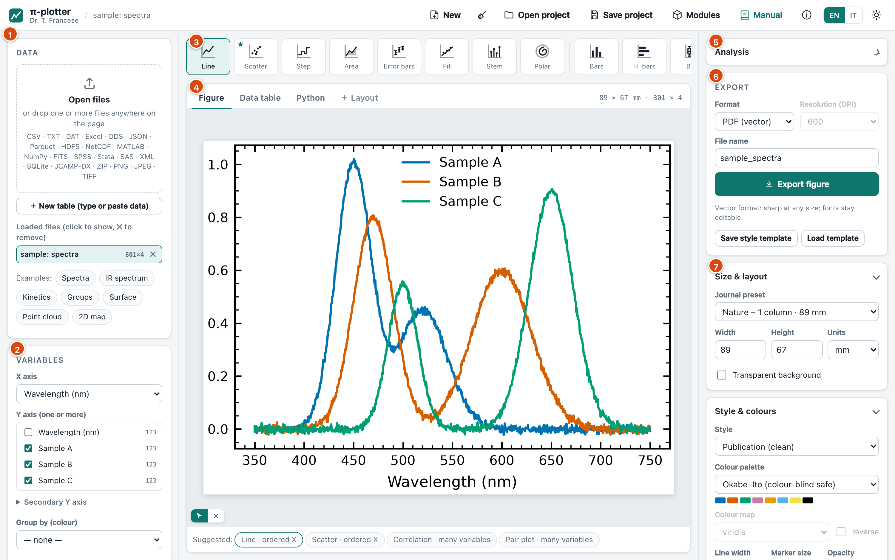
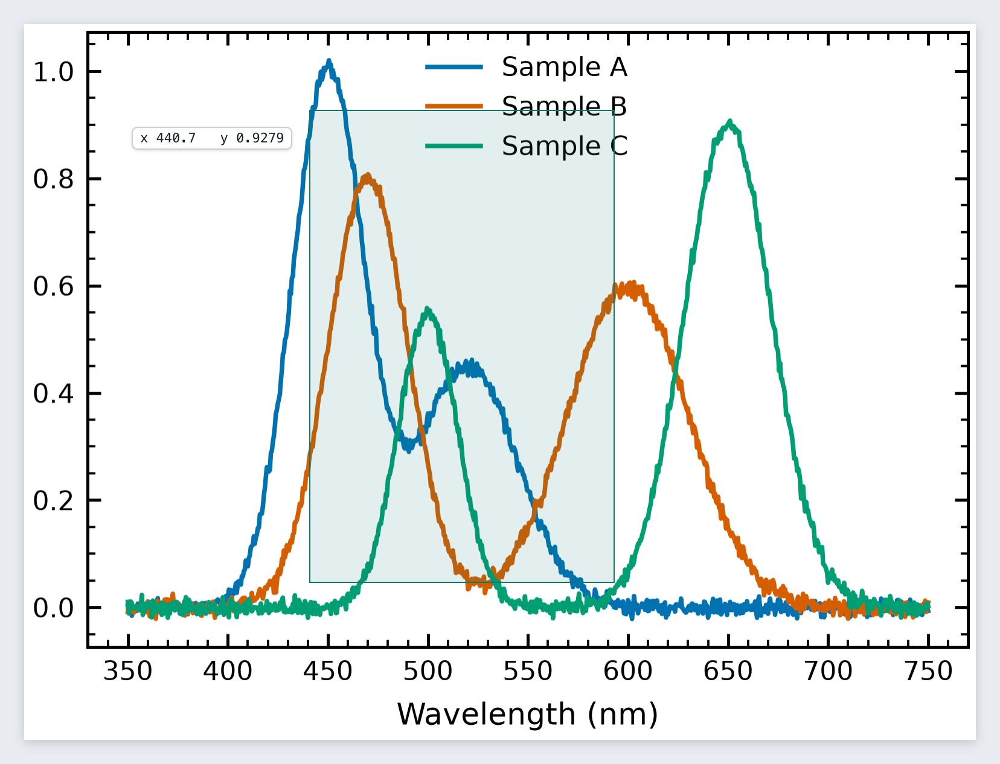
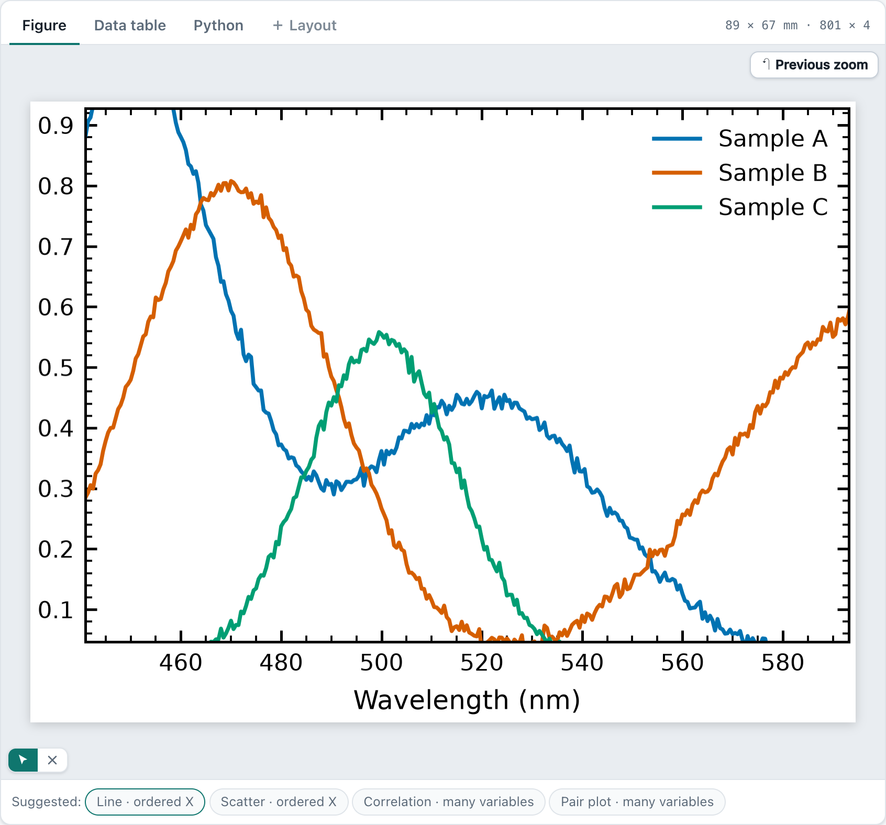
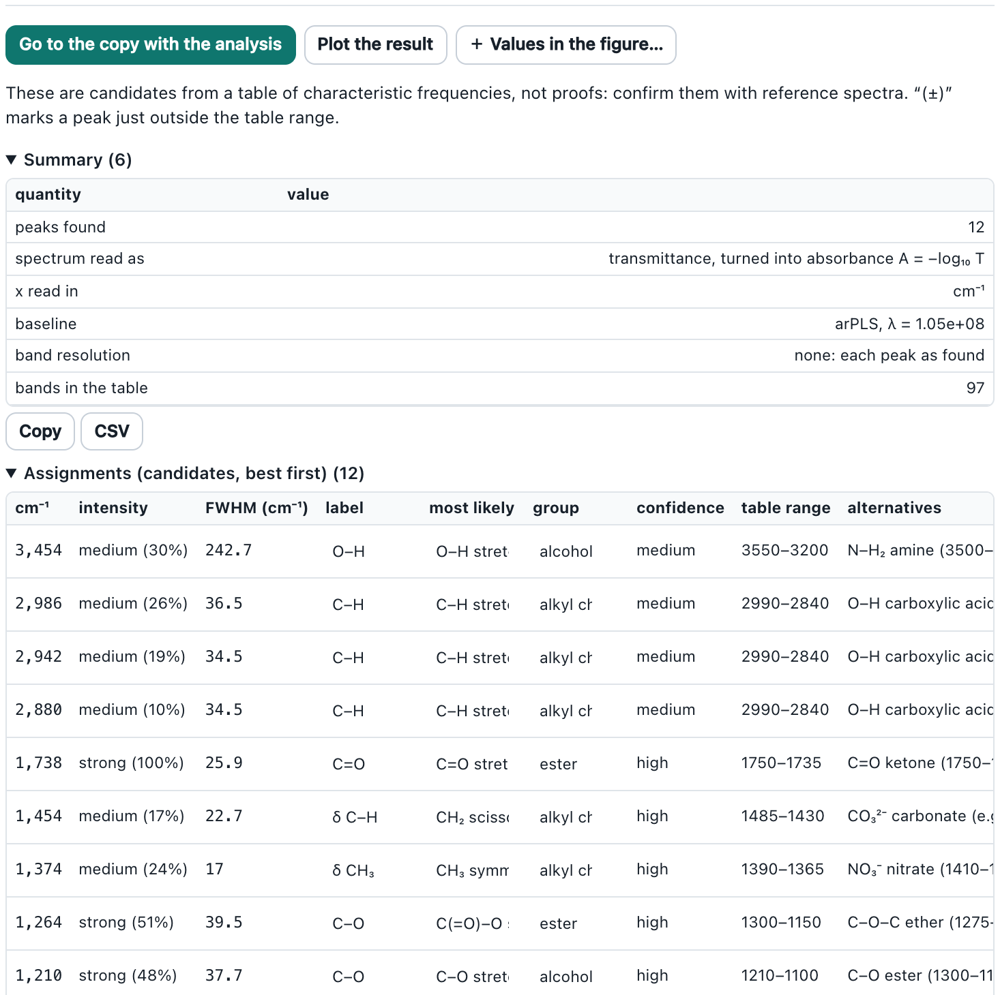

# π-plotter — User manual

*Dr. T. Francese*

π-plotter turns almost any data file into a publication-quality figure and analyses it with open-source Python modules (NumPy, SciPy, statsmodels, Matplotlib…), all in your browser and all on your own computer. This manual follows the order in which you work: **open the data → choose what to plot → style the figure → analyse (fit, peaks, statistics…) → export**. Every step has a picture taken from the program itself.

> **Tip:** the manual is available at any time from the **Manual** button in the top bar. It opens in a new tab, so you can keep it beside the program. The interface and the manual are in English and Italian (**EN / IT** in the top bar): the manual opens in the language of the program, and you can change it at the top right of the manual. The pictures are the same in both languages and show the English interface.

## 1. Before you start

### 1.1 Starting π-plotter

1. Install **Python 3.10 or newer** once ([python.org/downloads](https://www.python.org/downloads/)).
2. Start the program:
  - **macOS**: double-click `start_piplotter.command` (the first time: right-click › **Open** › **Open**).
  - **Windows**: double-click `start_piplotter.bat`.
  - **Linux** or any system: `python3 start_piplotter.py`.
3. A terminal window opens and your browser shows π-plotter at `http://127.0.0.1:8770`. **Keep the terminal window open** while you work; `Ctrl+C` in it stops the program.
4. The very first time, the page offers to install NumPy, pandas and Matplotlib (about 80 MB). Press **Install and start**; one progress bar shows the progress. They go into π-plotter's private environment (the `.venv` folder), never into your system Python.

Everything runs on your computer: the service listens on `127.0.0.1` only, and your files never leave it. Only the installation of modules (from PyPI) uses the internet.

### 1.2 The main window



The window has three columns:

| Number | Area | What it is for |
|---|---|---|
| 1 | **Data** (left) | Open files, example data sets, the list of loaded files, import options. |
| 2 | **Variables** (left) | Which column is X, which are Y, error columns, grouping, how several files are combined. |
| 3 | **Plot types** (top centre) | A bar of 27 plot types; the program suggests one (★). |
| 4 | **Figure / Data table** (centre) | The figure as it will be exported; a second tab shows the data. Tabs for analysis results appear next to them. |
| 5 | **Analysis** (right) | Choose an analysis, set its parameters, run it, read the numbers. |
| 6 | **Export** (right) | Format, resolution, file name. |
| 7 | **Size & layout, Style & colours, Series, Text & fonts, Axes & ticks, Legend** (right) | Everything that changes the look of the figure. |

In the top bar: **New** starts a new analysis (it closes data, figure and results but keeps your style), **Modules** manages the Python modules, **Manual** opens this manual, **ⓘ** shows licences and what to cite, **EN / IT** switches language, and the sun/moon button switches between light and dark mode.

## 2. Step 1 — Open your data

### 2.1 Open a file

Press **Open files** in the *Data* card, or simply **drop one or more files anywhere on the page**.

 and the Variables card (bottom). The loaded file appears in the list with its size: 801 rows × 4 columns.")

π-plotter reads CSV, TSV, TXT and DAT (separator, decimal comma, header, comment lines and text encoding are detected automatically), Excel (`.xlsx`, `.xls`), LibreOffice `.ods`, JSON, Parquet, Feather, ORC, HDF5, NetCDF, MATLAB `.mat`, NumPy `.npy/.npz`, FITS, SPSS, Stata, SAS, XML, HTML tables, SQLite, **JCAMP-DX spectra** (`.jdx`, `.dx`), **images** (PNG, JPEG, TIFF… — opened as matrices, see 5.9) and ZIP or compressed files (`.gz`, `.bz2`, `.xz`).

* If a format needs an optional module (for example `openpyxl` for Excel), a small window offers to install it, with a progress bar. Press **Install**; when it has finished the file can be opened.
* A file with several tables (Excel sheets, HDF5 datasets, SQLite tables…) shows a **Table / sheet / dataset** list under the examples: choose the one you want.
* The list **Loaded files** shows each file with its rows × columns. Click a name to show that file; click **✕** to remove it.

> **Tip — no data at hand?** The **Examples** buttons (*Spectra, IR spectrum, Kinetics, Groups, Surface, Point cloud*) load small synthetic data sets. All the pictures in this manual use them, so you can repeat every step exactly.

### 2.2 When the file is not read correctly

Open **Import options** (it appears under the examples for text files).


1. Change **Separator** (comma, semicolon, tab, bar, spaces) and **Decimal mark** if the columns are wrong.
2. Set **Header row** (or *none*) and **Skip rows** if the file starts with notes.
3. Press **Apply**.

If numbers with thousands separators are found (for example `1,234.5`), π-plotter asks whether to **Convert to numbers**; otherwise those rows would be missing from numeric plots.

### 2.3 Look at the data

The **Data table** tab shows the first rows with the type of each column (`float64`, `int64`, text, date…). Check here that numbers are numbers.


The table can be **edited** like a spreadsheet: click a cell and type (Enter goes down, Tab to the right, Esc cancels), or **paste** a block copied from Excel, LibreOffice or a text file (Ctrl/⌘+V at the chosen cell; rows and columns are added as needed). **＋ Row** and **＋ Column** add space, a click on the row numbers chooses rows to **delete**, a double-click on a column name **renames** it, ✕ on its header deletes it. **ƒ Column formula…** fills a column from the others, as *Set column values* does in other programs: `sqrt(A) * 2`, `col("time (s)") / 60`, `A - mean(A)`, `i` (the row number). Decimal commas are understood (`1,5`). **↶ Undo** (Ctrl/⌘+Z) goes back one change at a time. The figure and the analyses use every change at once; the original file is never changed.

**＋ New table (type or paste data)**, under *Open files*, starts from an empty table with columns A and B.

**Excluding points** (outliers, a bad measurement): choose rows by clicking their numbers and press **Exclude n rows**, or press **✕ Exclude points on the figure…** and click the points themselves (click again to bring one back; Esc ends). Excluded rows stay in the table, struck through; the figure shows them as grey crosses (*excluded* in the legend); every analysis leaves them out. **Include n rows** brings them back.

**Analyses follow the data**: after any change to the table (a value, a pasted block, excluded points, Undo), the analyses drawn on the copies of the figure, the result figures and the numbers in the panel are run again by themselves with the same settings, keeping their style. An analysis of a result (a fit of the peaks a peak search found) follows its result in turn. Until they have run on the new table, the tabs of the copies show ⟳ and the panel says the numbers are being computed again. If an analysis cannot run on the changed table — say the column it was made from was renamed or deleted — it never quietly takes another column: its tab shows **!** and the panel says its numbers come from an earlier version of the table, with **Run again** (for when the column is back); **Undo** makes them current again.

### 2.4 Several files at once

Open (or drop) several files together and they are drawn in **the same graph**, one colour and one legend entry per file. The **Combine files** section of the *Variables* card lets you choose which files, columns and error columns to include, or switch to **One panel per file**.


Analyses work on the file highlighted in **Loaded files**. To analyse another curve of the same graph, click its file: the figure stays as it is (same kind, style, curves and colours) and that file becomes the one analysed.

Analyses of different files go on **the same copy** of the figure: for example, run *Gaussian distribution of a column* on the first file, click the second file and run it again — the copy shows both histograms with both Gaussians and their values.

, (b): ready for a multi-panel journal figure.")

### 2.5 Very wide tables

Tables with thousands of columns (spectra series, for instance) are fine: every list of columns has **All / None**, a filter that also accepts a range of numeric names (`19600-19840`) or of positions (`#1-500`), and Shift+click ticks a whole block. A heat map draws all columns; a correlation matrix accepts up to 2,000 columns.

## 3. Step 2 — Choose the variables and the plot type

### 3.1 Variables

, Secondary Y axis, Group by (colour).")

* **X axis** — the column on the horizontal axis.
* **Y axis (one or more)** — tick every column to draw. Each becomes a series with its own colour.
* **Secondary Y axis** — columns drawn against a second axis on the right (for example temperature and concentration in the same plot).
* **Group by (colour)** — a text column whose values split the data into coloured groups.
* **X error / Y error** — appear for plot types that can draw error bars; choose the column that holds the uncertainties (columns called `err`, `std`, `sigma`, `errore`… are recognised automatically).

### 3.2 Plot types


The bar offers **27 plot types**: line, scatter, step, area, error bars, fit (with equation and R²), stem, polar, bars, horizontal bars, box, violin, strip, swarm, pie, histogram, density, ECDF, heatmap, contour, hexbin, 2D histogram, correlation matrix, pair plot, and three **3D** types (surface, 3D scatter, waterfall).

The program looks at the types of your columns and **suggests** the right plot: a ★ marks the first choice and the **Suggested** buttons under the figure give a few alternatives. A time series becomes a line plot, a point cloud a scatter (or hexbin if there are many points), categories become bars or boxes, X-Y-Z grids contour or heat maps.

> **Tip:** if the figure looks wrong, check the **Variables** card first: usually a column is ticked that should not be (the X column, a counter, an error column).

## 4. Step 3 — Make the figure look right

All the controls are in the right column. The figure is redrawn at once; it is always drawn at its **real physical size**, so what you see is what the journal will print.

### 4.1 Size, style, colours, series


* **Size & layout** — choose a **Journal preset** (Nature, Science, ACS, Elsevier, RSC, APS, IEEE, thesis page, slide, poster panel…) or type **Width** and **Height** in mm, cm or inches. A transparent background is one tick away.
* **Style & colours** — the **Style** (clean publication, white grid, ggplot, Science / Nature-like / IEEE-like from SciencePlots…), the **Colour palette** (Okabe–Ito and Tol are colour-blind safe) and, for heat maps and surfaces, the **Colour map**. Line width, marker size, opacity, line style and marker are set here for all series.

, label, line style, marker and width. *reset* returns to the automatic values.")

* **Series** — change the colour, legend label, line style, marker and width of **one** series. The colours of this card are exactly those of the figure.

> **Note:** journal names in the presets only describe column widths. They are trademarks of their owners, who are not affiliated with π-plotter.

### 4.2 Text, axes, legend


* **Text & fonts** — title and axis labels (by default the column names), the font and the sizes **in points**. Formulas go between dollar signs: `$\alpha$`, `$10^{-3}$`, `$\mu$m`, `$H_2O$`.
* **Axes & ticks** — linear, log or symlog scales; X/Y limits (empty = automatic); grid; tick direction, minor and mirrored ticks; frame; scientific notation; **Invert X** (for wavenumbers, which are read from high to low).
* **Legend** — shown automatically, always or never; position (also outside the axes); columns; title; frame.

#### Reference lines and bands

In **Reference lines & bands** press **＋ Line** and click on the figure where it goes — a vertical line at that x (choose *horizontal (at a y)* for a level) — or **＋ Band** and click its two ends to shade a range (a window of integration, a forbidden region, a range of normal values). Each one can then be typed exactly (*at*, *to*), given a **label**, a colour and a line style, hidden or removed; **On the figure** places it again by clicking. Labels sit at the edge of the axes and, like every text, can be dragged or double-clicked to rewrite them. Lines and bands are saved with the figure and in projects; dates are accepted on a date axis (`2024-05-01`).

#### Inset — a magnified region

In **Inset (magnified region)** press **Choose the region on the figure** and drag a box over the part to magnify (a small peak, the start of a curve): it appears magnified in a box inside the axes, with the same series and colours, the analysis curves and the reference lines, and thin lines that link it to the region. Change the region exactly (*X from / to*, *Y from / to* — empty Y follows the data), the corner (*Where*) and the *Size*; untick *Show the inset* to hide it. An automatic legend moves to the other side. It works on lines, scatter, steps, error bars, areas, stems, regressions and histograms.

#### Axis breaks

A break leaves out an empty or uninteresting range of an axis — the stretch between a cluster of small bars and one very tall one, or the months without measurements in a time series. In **Axes & ticks** press **＋ X break on the figure** (or **＋ Y break on the figure**) and drag across the range to leave out, or type it in *X breaks* / *Y breaks*: `12 – 95`, several separated by `;` (`12 – 95; 200 – 300`), dates as `2024-02-05 – 2024-05-28`. The range shrinks to a narrow gap marked // on the frame; both sides keep the same scale and get their own ticks. A curve is not joined across a gap of x; across a gap of y it goes on (a tall peak keeps its flanks). Analysis curves, reference lines, the inset, value boxes and points clicked on the figure all follow the broken axis. Breaks work on linear axes (not log), on lines, scatter, steps, error bars, areas, histograms and on the value axis of bars and box plots; the interactive HTML export shows the whole axis. Empty the field to remove the breaks. **X sides / Y sides (lengths)** give each side of the breaks a length of its own instead of the same scale: `1:3` makes the second side three times as long as the first (one number per side, from the left or the bottom), `equal` gives every side the same length — a cluster of small values then gets as much room as the one huge value above the break. Ticks, curves, clicked points and the inset follow.

#### Several figures in one — layout

Press **＋ Layout** next to the figure tabs: a new tab puts the figure and its copies (with analyses, result figures) side by side in one figure, with letters (a), (b)… — each panel keeps its own data, kind, curves, analyses, inset and reference lines. In **Layout of figures** tick the figures to include (the order of the ticks is the order of the panels), set the **Columns** and the letters. Next to each ticked figure, **↔** and **↕** choose how many columns and rows of the grid it takes: a wide spectrum across the top with two smaller panels under it, a tall one beside two. The panels fill the grid row by row in their order, so the letters read in order; size, fonts and an overall title are set as for any figure, and the letters can be dragged or rewritten. Change a figure in its own tab and the layout follows. It exports as PNG, TIFF, JPG, PDF, SVG or EPS and is saved in projects.

### 4.3 Zoom, move and rewrite directly on the figure

* **Zoom**: drag a box on the figure, or turn the mouse wheel. The axes are redrawn for the new range, not just magnified. Shift+wheel or a thin box zooms one axis only. **↶ Previous zoom** goes back one step, **⤢ Whole figure** shows everything (double-click on the plot does the same).





* **Move texts**: drag the title, an axis label, the legend, the colour-bar label, a pie slice label or a peak label to a new place.
* **Rewrite texts**: double-click a text, type the new one (formulas between `$…$`) and press Enter. *Original text* and *Original position* restore the automatic ones.

Zoom, moved and rewritten texts are kept in every export.

### 4.4 Three-dimensional figures

The 3D types are **surface** z(x, y) (from a regular grid or from scattered points, optionally as a wire frame), **3D scatter / line** and **waterfall** of spectra (one curve per column, at the depth given by the column name, such as a time or a temperature).


**Drag the figure to rotate it**: a light copy of the data turns smoothly in the page; when you release, the angles are kept and the figure is drawn again with Matplotlib. Double-click returns to the default view. The view angles and the Z limits are also in the *Axes & ticks* card.

### 4.5 Style templates

**Save style template** (in the *Export* card) writes all the style settings to a small JSON file; **Load template** applies it to any other figure. Use it to give a whole paper the same look.

## 5. Step 4 — Analyse the data

### 5.1 How the Analysis panel works

The **Analysis** card is at the top of the right column. The same five steps work for every analysis:

1. **Choose the analysis** from the list.
2. **Set the parameters** (columns, model, limits…). The columns are proposed from your variables.
3. Press **Run analysis**.
4. **Read the results** under the button: a summary table, tables of parameters, plain-language sentences, and the **references to cite**. *Copy* and *CSV* export any table.
5. Look at the result on the figure with **Show on a copy of the figure**, or open a result that has its own axes (autocorrelation, power spectrum, Q–Q plot…) with **Plot the result**.


> **Note:** **your original figure is never modified.** Analysis curves are drawn on a *copy*, in a tab next to *Figure* (close it with **×**). Analyses you run while a copy is open are added to that copy, which has its own style and exports like any figure. **← Back to the original figure** returns to the data.

The analyses are grouped as:

| Group | Analyses |
|---|---|
| **Recipes** | Gaussian distribution of a column · Mean of a time series · Equilibration of a simulation · Are the groups different? · Relation between two variables · Peak fit · Reaction kinetics |
| **Fitting** | Curve fitting |
| **Time series & correlation** | Autocorrelation (ACF / PACF) · Block averaging · Cross-correlation |
| **Statistics** | Descriptive statistics · Normality tests & Q–Q plot · Compare groups · Correlation · Linear regression & ANOVA · Distribution fitting |
| **Signal processing** | Smoothing & derivative · Power spectrum · Baseline · Peak finding · IR peak assignment · Integral & area |

**Recipes** are the easy way in: each one chains several analyses, chooses sensible defaults and answers in plain words. If you are unsure, start from a recipe.

**Suggested for this figure**: above the list, π-plotter proposes the analyses that suit the figure on screen, best first, and the list starts with them (★). A histogram gets the Gaussian recipe and distribution fitting; a spectrum (x in nm, cm⁻¹, eV…) baseline, peaks, peak fit (and IR assignment for cm⁻¹); a signal that decays, kinetics and an exponential fit; a series in time, its mean with the true error, equilibration and autocorrelation; bars or boxes per group, the comparison of the groups; a cloud of points, the relation between the two variables. Hover a suggestion for the reason; choosing it also sets useful starting values (e.g. Curve fitting of the histogram with a Gaussian).

Every analysis uses established open-source modules (SciPy, statsmodels) and gives you the **references to cite** with the results.

> **Values in the figure, from any analysis:** fits write their values in a box by themselves; for every other result (descriptive statistics, tests, peaks, areas, a batch…) press **＋ Values in the figure…** under the result, tick the numbers (a mean comes with its standard error, e.g. *mean = 0.240 ± 0.055*), change the text if you like and press **Add to the figure**. The box goes on the figure on screen: drag it, double-click it to rewrite it, and change its text or colour, hide it or remove it under **Overlays**. It is saved with the figure and in projects.

### 5.2 Fitting a curve — worked example (kinetics)

Goal: fit a decay to the concentration of a reactant and obtain the lifetime with its error.

1. Press **Examples › Kinetics**. In the *Variables* card keep **Time (min)** as X and tick only **Concentration (mM)** as Y. Choose the plot type **Error bars** and, as **Y error**, **Std. dev. (mM)**.
2. In *Analysis* choose **Curve fitting**.


3. Set **Y error (weights, optional)** to **Std. dev. (mM)**: points with a larger error then count less.
4. Choose the **Model**: exponential (also double and stretched/KWW), power, Gaussian, Lorentzian, Voigt, logistic, Hill, Michaelis–Menten, Arrhenius, sine, polynomials — or write **your own formula** in x, for example `a*exp(-x/tau) + c`. Here: `y = A·exp(−x/τ) + C`.
5. Optional: give **Starting values** (`tau=10, c=0`) and **Limits** (`a=0..inf, tau=1..100`) if the fit does not converge; choose the **Error band** (95 % confidence of the curve, prediction band, or none); restrict the range with **Fit from x =** and **Fit up to x =**.
6. Press **Run analysis**.


How to read it:

* **R², adjusted R², RMSE, χ²_red** tell how well the curve describes the data (χ²_red close to 1 means that the scatter agrees with the error bars you gave); **AIC** and **BIC** let you compare models — the lower, the better.
* **Fitted parameters** lists value, standard error, 95 % confidence interval and relative error. Here τ comes out close to 14 min, the value used to generate the example.

7. Press **Show on a copy of the figure** to draw the curve and its error band over your data.

. The original figure is untouched.")

> **Tip:** *Curve fitting* also fits the **histogram of a column** (for example a Gaussian over a distribution of values): use **Data to fit** to choose the histogram of the column (it is picked automatically when the figure is a histogram) and, if you want, the number of **Histogram bins**.

#### Several curves at once — global fit and fit report

When the figure holds **several curves** — more Y columns, or other files ticked in *Loaded files* — choose **Global fit of several curves** (it is suggested as soon as there is more than one curve). One model is fitted to **every curve of the figure at once**:

* **Shared parameters** — write their names, e.g. `tau`: they take **one value for all the curves** (one lifetime for decays measured at several temperatures), fitted to all the data together, so their error is smaller than from any single curve. The other parameters (here A and C) stay **each curve's own**.
* A parameter can also be shared by **some curves only**: `tau[1,2], tau[3-5]` gives one τ to curves 1–2 and another to curves 3–5 (the numbers of the report table). **Fixed parameters** (`C=0`) are kept at that value for every curve.
* **Constraints** tie a parameter to others: `A2 = 2*A1` (with the two-exponential model) makes A₂ twice A₁ on every curve; `A[2] = 2*A[1]` makes the A of curve 2 twice that of curve 1. Several are separated by `;`, and the right side may use numbers, + − × ÷, powers and exp, log, sqrt… A constrained parameter is **computed, not fitted** (it is not shared or fixed at the same time, and limits do not apply to it); its error in the report comes from the errors of the parameters it is made from (propagated through their covariance).
* **Weights:** when every curve has a **Y error** column in the figure, its points count as 1/σ² and the result gives χ²_red; choose *none* to weigh all points the same.
* Leave it **empty** for a **batch fit**: each curve fitted on its own, with the same numbers as *Curve fitting* would give one by one.
* The **Fit report** table has **one row per curve**: file (and column), N, every parameter with its error, R² and RMSE. *Plot the result* draws a parameter against the curve number; the table exports like any data.
* Every curve gets its fitted line on a copy of the figure, and the shared values are written in a box in the figure (option *Write the shared values in the figure*). Excluded points stay out of the fit.

#### The same analysis on every file — batch

With **several files loaded**, the Analysis panel has a button **Run on all n files** next to *Run analysis*: the analysis runs, **with the settings in the form**, on every file in *Loaded files*, and gives **one table with one row per file** — e.g. τ ± σ(τ), R², RMSE of the same exponential fit on twenty measurements.

* The columns **follow each file**: the X and Y chosen for the file on screen become each file's own X and Y (as the figure draws them), so files with different column names work together.
* **Choose the files** (under the buttons) lists the loaded files: untick the ones to leave out, and the button becomes **Run on the n chosen files**.
* **Run on a folder…** runs it on every file of a folder you choose, **without loading them**: only the files with the same extension as the one on screen (hidden files and macOS `._` files left out), in the order of their names (`run 2` before `run 10`), each read with the columns of the figure. They are not added to *Loaded files*; the table remembers them, so a project saved afterwards contains them. This works with a single loaded file too.
* A file where the analysis cannot run (too few points, a column missing) is listed under **Files where it failed**, with the reason; the others are still done.
* The table opens as a **figure of its own** — the first number against the file number, with its error bars — and can be styled, exported and saved in a project like any data.

### 5.3 Reaction kinetics in one click

The recipe **Reaction kinetics (order, k, t½)** fits zero-, first- and second-order laws to the same data, compares them with the AIC, and gives the best order, the rate constant *k* and the half-life with errors. Choose time as X, the concentration as Y (and its error column as *Error of y*) and press **Run analysis**.


 on a copy of the figure.")

> **On a histogram:** with a histogram of a column on screen, *Baseline*, *Peak finding*, *Peak fit*, *Integral* and *Smoothing* work on the histogram as drawn — its bins, in counts or density — instead of the column's values one after the other. So the anchor points clicked on the figure (*Pick on the figure*) are in the figure's units (value, count or density), the peaks are the modes of the distribution, and the area of a density is 1. The result says so in its first line.

### 5.4 Spectra and chromatograms: baseline → peaks → peak fit → area

For any signal with peaks (UV-Vis, IR, Raman, XRD, chromatograms…) work in this order: **baseline first, then the analysis**.

#### Step 1 — Baseline

Choose **Baseline**. By default the program draws a **straight line under the signal**; you can also click the anchor points yourself, or choose a method that follows a curved background.

, and the direction of the peaks recognised from the signal.")

* **Automatic: straight line under the signal (or polynomial)** — the default. The line is fitted to the points that lie on the baseline; points higher than the line by more than three times the noise (the peaks) do not pull it up (Mazet et al., 2005). **Shape** sets how it may bend: **0** a flat, constant level; **1** a straight line (the default); **2–6** a gently curved polynomial for backgrounds that bend. Where the signal has no peaks, the corrected signal is flat.
* **Anchor points (click on the figure)**: press **Pick on the figure** and click where the signal lies on its baseline, between and around the peaks; press **Esc** or **Done** when finished (**Remove last** and **Clear** correct mistakes). **Each click keeps its x and its y**, so the point stays exactly where you clicked (the text box shows `x y`, one point per line). A point written with **x alone** takes the height of the signal there. Choose whether the points are joined by straight lines or by a smooth curve.
* **Automatic methods that follow curved backgrounds**: *arPLS*, *asymmetric least squares*, *SNIP* or *rubber band*. Change **Stiffness** (lower follows the signal more) or **Asymmetry** if the line climbs into broad peaks.
* **The peaks point**: up (absorbance, counts, intensity) or down (transmittance, dips). With **recognise from the signal** the program decides from the shape of the data: for a transmittance spectrum like the example the baseline is drawn **above** the dips, along the top of the spectrum.

Two more choices decide what you get:

* **Correction** — how the baseline is taken out of the signal. *Automatic* **divides** a transmittance (or reflectance) spectrum by its baseline, T / T₀ × 100, so the corrected spectrum stays in % with the baseline at 100 % and the bands as deep as before; any other signal has the baseline **subtracted**, so its baseline is at 0. You can also force *subtract* or *divide*.
* **Also show the spectrum before the correction, with its baseline** — off by default.

Press **Run analysis**, then the green button under the results:

* With the option **off** (the default) the button is **Plot the result**: a new tab shows **only the corrected spectrum**, with the corrected baseline as a dotted line (at 100 % or at 0). The original figure is not touched.

 between the bands, which keep their depth.")

* With the option **on** the button is **Show on a copy of the figure**: the copy shows the spectrum before the correction, its baseline (dashed) and anchor points, and the corrected spectrum, so you can compare them. *Plot the result* gives the same curves in a figure of their own.

 and the corrected spectrum together.")

> **Note:** the corrected spectrum is a new data set: in its tab you can style it, export it, or analyse it further. Its **Data table** contains x, the original signal, the baseline and the corrected signal.

The results also say which way the peaks point, which correction was used, and how many points lie on the wrong side of the baseline; above 5 % the program warns that the line cuts into the signal there.

*Peak finding*, *Peak fit* and *Integral* then offer the same baseline already selected, so heights, widths and areas are measured **above it**.

#### Step 2 — Peak finding

Choose **Peak finding**. It finds peaks by **prominence** (use **Minimum prominence** to ignore noise; empty means 5 % of the range) and reports position, height, FWHM and area above the baseline. Use **Only from x / to x** to restrict the range, or **Find minima instead** for dips. The **position is written above each peak**; crowded labels move aside with a leader line.


#### Step 3 — Peak fit

The recipe **Peak fit (spectra, chromatograms)** finds the peaks and **fits them all together** with Gaussian or Lorentzian shapes (**Peak shape**): centre, height, FWHM and area of each peak, with errors. Each peak stays inside its own region. As **Baseline** you can also choose a straight line or a constant fitted together with the peaks.


, the individual peaks (dotted) and the peak positions above them.")

> **Note:** the area errors ignore the correlation between height and width (they are approximate), and errors are conditional on the baseline, which is subtracted and not fitted.

#### Step 4 — Integral

**Integral & area** gives the area under the curve between two x values (**From x / To x**) and the cumulative integral, optionally above the same baseline.

### 5.5 IR peak assignment

On a mid-infrared spectrum (absorbance or transmittance; wavenumber in cm⁻¹, or wavelength in µm or nm) **IR peak assignment** finds the peaks and lists for each the **candidate groups** from a table of about 110 characteristic bands: organic groups, and inorganic anions and minerals (carbonates, sulfates, silicates, oxalates…) for materials and conservation science.

1. Press **Examples › IR spectrum**, or open your own spectrum.
2. Choose **IR peak assignment**. The program recognises transmittance or absorbance and the unit by itself (**The spectrum is**, **X unit** = *auto*); change them if needed.
3. **Compare with** chooses the table: *all the table*, *organic groups* or *inorganic anions and minerals*; **Organic groups with** is *C, H, O, N only* unless you choose *also S, P, Si, halogens*.
4. Press **Run analysis**, then **Show on a copy of the figure**.



.")

The candidates are ranked by band range, intensity and width, and by the other bands the same group needs: an ester C–O only with an ester C=O, an aryl ether only with an aromatic ring, organic groups only with C–H bands.

**Your own assignments.** The table of assignments is editable. Write in a cell of **label** (what the figure shows above the peak), **most likely** (the vibration), **group** (the box suggests the groups of the table, but any text is accepted) or **note**; press **Add a peak** to give a position (cm⁻¹) the program did not find, with or without an assignment (left empty, the table assigns it); press ✕ to remove a peak from the table and the figure. Then press **Apply**: the analysis runs again, your rows are highlighted and marked *you* in **assigned by**, they replace the table's candidates (the automatic ones stay under **alternatives**), the labels in the figure and the **Groups compatible with the peaks** follow, and your assignments count as certain (no confidence is given). They are kept when you run the analysis again with other options, and cleared by **Restore the table's assignments** (or **Reset**).

> **Important:** these are **candidates, not proofs**. Confirm with reference spectra. The table of bands (`BANDS` in `piplotter/analyses/ir_assign.py`) can be edited with **Customise…**; its sources are listed in `REFERENCES.md`.

### 5.6 Simulations and time series

#### Equilibration of a simulation (MD, Monte Carlo)

For a trajectory (energy, density, RMSD…) the recipe **Equilibration of a simulation** finds automatically **where the series is equilibrated** and gives the average of the equilibrated part **with its true error**. Choose the series (and the time column) and press **Run analysis**.


The start is chosen with the method of Chodera (2016): it keeps as many independent samples as possible.

#### Mean of a time series

**Mean of a time series (correlated data)** gives the mean with its true error, the correlation time and the number of independent samples. Use **Discard the first … %** to remove an equilibration period by hand.

#### Autocorrelation and block averaging

Consecutive points of a simulation or sensor log are **not independent**, so the usual error of the mean (SD/√N) is far too small.

* **Autocorrelation (ACF / PACF)** (rows must be equally spaced) draws the ACF with its confidence band and gives the integrated correlation time τ, the **statistical inefficiency** *g* and the **effective number of samples** N/g.


, the 95 % band (dashed) and the exponential fit of the initial decay (dotted). It opens as its own figure, in a tab with × to close it.")

* **Block averaging (error of correlated data)** (Flyvbjerg–Petersen) shows how the error estimate grows with the block size and levels off at the true error. If the curve does not reach a plateau, the series is too short.
* **Cross-correlation** compares two series as a function of the lag and finds the delay of best match.

### 5.7 Statistics

#### Gaussian distribution of a column

The recipe **Gaussian distribution of a column** draws the histogram, fits a Gaussian, checks the normality and gives the mean, σ and FWHM and the **true error of the mean**. **Rows are a time series** is ticked by default, so that the error of the mean is corrected for correlated values; untick it for independent measurements.


When the figure is a histogram of that column (also with other files in it), the Gaussian is drawn on a copy of **your** histogram, over its bars, with a box of values (mean, μ, σ, FWHM, R²) in the colour of the curve: drag the box, double-click it to rewrite it, or untick **values in the figure** under *Overlays*. Untick **Draw the fit on the histogram of the figure** to get the figure of its own instead. The fit starts from the mean and spread of the values and keeps the baseline C ≥ 0, so broad or flat-topped distributions are fitted too. Every **Curve fitting** writes its fitted values in the figure in the same way (option **Write the fitted values in the figure**).

#### Are the groups different?

Open the **Groups** example, choose **Box** as plot type and the recipe **Are the groups different?** with the *Values* and *Group* columns. The right test is chosen **automatically**: each group is checked for normality (Shapiro–Wilk), then a Welch t-test (two groups) or a one-way ANOVA with Tukey HSD is used, or, if the data are not compatible with a normal distribution, Mann–Whitney or Kruskal–Wallis. The answer is written in plain words, with effect size and pairwise comparisons.

”, the test chosen, the effect size, per-group statistics and the pairwise table.")


For full control use **Compare groups (t-test, ANOVA…)**: t-tests, Mann–Whitney, Wilcoxon, ANOVA, Welch's ANOVA, Alexander–Govern, Kruskal–Wallis, Friedman and effect sizes. With more than two groups the pairwise comparisons follow the test: **Tukey HSD** after an ANOVA, **Games–Howell** after Welch's ANOVA (unequal variances), **Dunn** with Holm's correction after Kruskal–Wallis, and Wilcoxon signed-rank pairs with Holm's correction after **Friedman** (the same subjects measured under three or more conditions, one row per subject).

#### Two categories: contingency table

Are two categories related — treatment and outcome, batch and defect? **Contingency table (χ², Fisher)** counts the cases of each pair from two columns of categories (one row per case), or takes counts already tallied (one column per category, one row per label). It gives the observed and expected counts, the χ² test of independence (with Yates' correction for a 2×2 table), **Cramér's V** (0 = unrelated, 1 = fully related) and the **adjusted residuals**: cells with |r| > 2 are the ones that make the difference. For a 2×2 table it also gives **Fisher's exact test** and the **odds ratio** with its confidence interval; when expected counts are below 5 the conclusion uses Fisher's test. The counts are drawn as grouped bars.

#### Many columns: principal components and clusters

**Principal components (PCA)** sums up many numeric columns (one row per sample) in a few components: the explained variance of each one, the **loadings** (how much each column weighs) and the **scores plot** PC1 vs PC2, coloured by a group column if you give one. Keep **Standardise the columns** ticked when the columns have different units. **Cluster analysis (k-means, Ward)** finds groups of similar rows without being told them: give the number of clusters, or leave it empty and the best one between 2 and 8 is chosen by the **mean silhouette** (close to 1: well separated; below 0.25: weak structure). The result table has every row with its cluster, ready to colour a figure or to feed **Compare groups**.

#### Two factors, repeated measures, mixed models

**ANOVA: two-way, repeated measures, mixed model** (statsmodels) has three designs:

* **Two-way** — a value and two factors measured on different subjects (e.g. treatment × batch): the effect of each factor and of their **interaction**, with type II or type III sums of squares (type III as SPSS and Origin give), partial η², and the mean, SD and n of every cell, drawn as grouped bars.
* **Repeated measures** — the same subjects measured under every condition: a long table (subject, condition, value — plus a second within-subject factor if any) or **one column per condition** with one row per subject. Subjects without a value in every condition are left out (and counted). With one factor, **Mauchly's test** says whether the variances of the differences are equal (sphericity); when it fails read the **Greenhouse–Geisser** p (the Huynh–Feldt one is also given). The F tests come from orthonormal contrasts, the same numbers as the classical sums of squares.
* **Mixed model** — fixed factors and a **random intercept per subject** (REML): for unbalanced designs or missing values, where repeated-measures ANOVA would drop subjects. It gives the fixed effects with their intervals, a Wald test per factor, the variance between subjects, the residual variance and the **intraclass correlation**.

#### Survival: Kaplan–Meier

**Survival (Kaplan–Meier, log-rank)** needs the time to the event (or to the end of the follow-up) and a column saying whether the event happened (1) or the case was censored (0) — leave it empty when every case had the event. It draws the Kaplan–Meier curve of each group with its 95 % band (Greenwood, on log(−log S)), gives N, events, censored and **median survival** per group and, with two groups or more, the **log-rank test** of whether the curves differ.

**Cox regression (hazard ratios)** goes further: how covariates — a treatment, a dose, an age — change the hazard of the event. Give the time, the event column (empty = every case had the event) and the covariates (text columns become categories, compared with the first one). It gives the **hazard ratio** of each covariate with its 95 % interval and p, the likelihood-ratio test of the whole model, **Harrell's concordance** (0.5 = no better than chance, 1 = orders every pair right) and, per covariate, a check of **proportional hazards** (Schoenfeld residuals against time): when an effect changes with time the hazard ratio is only an average, and the result says so.

#### Relation between two variables

The recipe **Relation between two variables** gives the correlation (Pearson and Spearman, with p-values), a straight-line fit with its confidence band and a check of the residuals.


#### The single analyses

| Analysis | Use it to… |
|---|---|
| **Descriptive statistics** | N, mean, SD, SEM, confidence interval, median, quartiles, skewness, kurtosis; also split by a group column. |
| **Normality tests & Q–Q plot** | Check whether a sample is compatible with a normal distribution (four tests and a Q–Q plot). |
| **Correlation** | Correlation matrix (Pearson, Spearman, Kendall) with p-values and confidence intervals. |
| **Linear regression & ANOVA** | Ordinary least squares with one or more predictors or a formula such as `y ~ x + C(group)`; coefficients, p-values, R², AIC, ANOVA table and diagnostics. |
| **Distribution fitting** | Maximum-likelihood fit of several distributions; the best one by AIC; histogram with the densities. |
| **Smoothing & derivative** | Savitzky–Golay (with 1st / 2nd derivative), moving average or Gaussian filter. |
| **Power spectrum** | Frequency content of an equally spaced signal (FFT or Welch) and its dominant frequencies. |

### 5.8 Signal tools

All of them work on the curve on screen (on a histogram, on its bars) and give a new curve, drawn on a copy of the figure and available as data to plot and export. Points unevenly spaced are first resampled evenly where the method needs it, and the result says so.

* **Interpolation & resampling** — the curve on a new x grid: evenly spaced (a number of points or a step, in a range), **the x of another file of the figure** (to bring two measurements onto the same x before comparing them), or values written. Methods: linear, cubic spline, PCHIP (follows the shape, never overshoots), Akima, smoothing spline (through noisy data; for exact data use cubic or Akima), nearest point. Nothing is invented outside the data.
* **Decimation (keep the peaks)** — a very long signal (a recording of millions of points) reduced to a few thousand points that keep its look: **LTTB** (Largest-Triangle-Three-Buckets) keeps the shape, **min / max of each slice** (M4) keeps every highest and lowest point; block averages (less noise, peaks flattened) and every k-th point (peaks can be lost) are there to compare. The summary gives the highest and lowest value before and after. A figure draws very long lines (over 100,000 points, without markers) the M4 way by itself: the picture is the same, drawn and exported in about half the time, while the table, the analyses and the points clicked still use every point; zoomed in, all the points of the window are drawn.
* **Frequency filter** — low-pass (noise away), high-pass (drift away), band-pass, band-stop (e.g. mains 50 Hz). Frequencies are in cycles per unit of x (Hz when x is in seconds; empty = one tenth of the Nyquist frequency, half of 1/step). *Butterworth, zero phase* filters forward and backward so peaks do not move; *ideal cut in the FFT* removes the frequencies outright. The table gives the step, the Nyquist frequency and how much was removed.
* **Convolution & deconvolution** — broaden with a Gaussian, Lorentzian, box or one-sided exponential kernel of a given width (FWHM, in x units), or remove a known broadening: *Wiener* (regularisation: larger = smoother) or *Richardson–Lucy* (iterative, for positive signals such as spectra and counts). The FWHM before and after is reported.
* **Arithmetic of two curves** — A − B, A + B, A × B, A ÷ B or **A − k·B with k fitted** (subtract a background, a solvent or a blank measured apart). A and B are numbered as in the figure (its Y columns, then the other files ticked); B is interpolated at the x of A where they overlap, so the two may come from different files.

The derivative of a curve is in *Smoothing & derivative*, the cumulative integral in *Integral & area*, the power spectrum in *Power spectrum (FFT / Welch)*.

### 5.9 Matrices and images

A **matrix** is a grid of values: a map, a 2D spectrum (time × wavelength), an image. π-plotter keeps it in a table with the first column holding the y of each row and the other columns **named by their x** — the "XYZ matrix" many instruments write (`Delay (ps), 450, 455, 460, …`). Such a table is recognised when it is opened: the figure is a **heat map** with numeric x and y axes, and *Contour* and *3D surface* draw the same grid. Try the **2D map** example (a band decaying while another grows).

**Images** (PNG, JPEG, TIFF, BMP, GIF, WebP) open as matrices of intensities: grey levels as they are (8 or 16 bit), colour as luminance — or one channel: a colour picture offers *luminance*, *red*, *green* and *blue* under **Table**, and **＋ R, G, B as three files** opens the three channels at once as loaded files, to analyse together (*Run on all files*: one row per channel) or to put side by side in a layout. The pixels are the coordinates, y counted from the bottom so the picture stands upright; images larger than 4096 pixels on a side are binned down. Values can be measured on them like on any map — the brightness along a line across a band, the mean intensity of a spot.

Four analyses, in **Matrices & images**, work on the matrix of the figure (or on X, Y, Z columns mapped as such):

* **Matrix: profile along a line** — the values along a segment whose two ends you **click on the figure** (or along a row at a y, a column at an x), averaged over a strip a few cells wide if asked. Gives the curve, its maximum and where it is; the path is drawn on a copy of the figure.
* **Matrix: statistics of a region** — click two opposite corners (a rectangle), three or more points around the region (a **polygon** of any shape: a cell counts when its centre is inside; the area of the polygon is given too), or nothing for the whole matrix: number of cells, mean, SD, median, minimum and maximum with their position, sum, **volume** (∫∫ value dx dy) and **centroid**; the rectangle is drawn on the figure and the values given as a histogram.
* **Matrix: find spots / particles** — the connected regions brighter (or darker) than a threshold: **n σ** above the background (median and robust σ of the matrix), **Otsu**'s automatic threshold, or a value; an optional smoothing guides the detection only. A table gives, for each spot, its cells, area, equivalent diameter, centroid (weighted by the values above the threshold, to a fraction of a cell), peak and its position and integral; the count, the mean area and the covered fraction are in the summary. Spots smaller than a minimum and, if asked, those touching the edge are left out; the centroids are marked + on a copy of the figure.
* **Matrix: smooth & filter** — Gaussian, median (removes isolated spikes and keeps edges) or moving-average filter, **subtraction of a background plane**, normalisation to 0–1, the **2D FFT power spectrum**, **low-pass** and **high-pass** filters in the Fourier domain (Butterworth: give the size of the structures at the cut, in cells, and the order — keep the broad shapes, or keep the fine detail on a flat background) and **edges** (the steepness of the matrix, Sobel). Empty cells stay empty and do not spread.
* **Matrix: reshape & convert** — crop to a range, bin blocks of cells, resample on a new grid, transpose, flip, rotate by 90°, and convert between a matrix and **X, Y, Z columns**; from **scattered X, Y, Z points** it builds a regular grid by interpolation (Delaunay triangulation).

Each result is a new matrix (or curve) in a tab of its own, which can be analysed again, plotted, exported or put in a layout.

## 6. Step 5 — Export


1. Choose the **Format**:
  - **PNG**, **TIFF (LZW, for journals)**, **JPEG** — raster images at 150, 300, 600 or 1200 **DPI**;
  - **PDF**, **SVG**, **EPS** — vector formats; the text stays editable (fonts are embedded as TrueType);
  - **Interactive HTML** — a page made with Plotly (zoom, hover) that opens in any browser;
  - **Python script (.zip)** — the data, the settings, a script and the references: it **recreates the figure without π-plotter** (`python make_figure.py`).
2. Type a **File name**.
3. Press **Export figure**. The file goes to the downloads folder of your browser.

The line under the button tells the size: for instance *1050 × 790 px at 300 DPI*, or *Vector format: sharp at any size*.

> **Tip:** the exported figure has exactly the physical size you chose in *Size & layout*. A copy with analysis curves is exported like any other figure: select its tab first.

### Saving the whole work: projects

**Save project** (top bar) writes everything into one **.piplot** file: the data files you opened (byte for byte, so it opens on any computer), your edits to the tables, the tables you wrote by hand, the figure, its copies with the analyses and their values, the result figures and the parameters of every analysis. **Open project** (or dropping a .piplot file on the page) puts it all back: the analyses are run again from the same data and settings, so the numbers are the same. Projects saved by a newer π-plotter ask you to update. A project is written to disk and downloaded in pieces, so one with many GB of data does not need that much memory.

**Autosave.** While you work, π-plotter keeps a copy of it on disk a few seconds after each change (and every 20 seconds): the same description as a project, with a copy of the data files it uses, in `~/.piplotter/autosave/`. If the browser, the computer or π-plotter stops before you saved a project, the next start shows **Your last work … Get it back?** on the empty page: **Recover** puts it all back as a project would; **No, start afresh** deletes that copy. The copy of the session before is kept too, so starting new work never overwrites the last one. The autosave is not a substitute for **Save project**: it keeps only the last two sessions, on this computer.

### Citing


In the methods of your paper cite Matplotlib and the other modules used for the figure. The **ⓘ** button lists every module with its licence and the reference to cite, and every *Python script* export includes a `REFERENCES.txt` with exactly those references. Analysis results show the references of the methods they used.

## 7. Plugins and modules

### 7.1 Your own analyses (plugins)

Every analysis is a small Python plugin. At the bottom of the *Analysis* card:

* **Customise…** (next to the description of a built-in analysis) opens an editable copy of it. The copy replaces the built-in one; when π-plotter is updated and the built-in one changes, the list marks your copy *your copy — the built-in one is newer* (disable the copy to use the new one);
* **New plugin** asks for a name and opens a template;
* **Plugins folder** opens the folder where your plugins live (`~/.piplotter/plugins/`), which survives updates;
* **⟳** reloads the plugins after you edited a file elsewhere.


A plugin declares its parameters in a `PLUGIN` dictionary and implements `run(df, p, ctx)`. Write what you want to show with `ctx.result()` (values, tables, text, references, a data set to plot). The full guide, with examples, is in `PLUGINS.md`.

> **Warning:** plugins are Python code running with your user rights. Install only plugins you trust.

### 7.2 Python modules

The **Modules** button lists every module π-plotter can use, with its licence and the installed version.


* At every start the program checks PyPI for newer versions (*Check for updates*; **Update all** with one click). Missing modules are offered when a feature needs them.
* **Check imports** loads each module in a separate Python: one that cannot be loaded is shown in red with its error and a **Reinstall** button.
* **Your modules (from PyPI)**: type the name of any package, press **Check**; π-plotter asks pip what it would install (nothing changes yet) and shows each package with its **licence**. Open-source licences install normally; any other licence needs a tick in *“I have read the licence terms…”*. After installing, the module is imported **with its submodules**; if it cannot be used it is **removed again** together with what came with it, and you see why. A module that imports is available to plugins; its icon appears at the end of the plot-type bar, listing its functions.

> **Warning:** modules you add are third-party code that π-plotter does not check. Install only what you trust. The licence check reads the package metadata; it is a help, not legal advice.

### 7.3 The Python console

For what no button does, the **Python** tab (next to *Figure* and *Data table*) runs Python code on the open data. Write the code, press **Run** (or Ctrl/⌘+Enter): what it prints appears under it, the value of the last line is shown (a table as a table), and the figures made with Matplotlib are drawn. Variables stay from one run to the next, as in a notebook; Ctrl/⌘+↑ ↓ bring back the code run before.

* `df` — the data of the figure on screen, as a pandas DataFrame (a copy: changing it changes no table)
* `files` — the open files, `{name: DataFrame}`; `spec` — the figure (kind, X, Y…)
* `np`, `pd`, `plt` — NumPy, pandas, Matplotlib
* `new_table(frame, "name")` — opens a DataFrame (or a dict of columns) as a **new table** in the list of files: it can be plotted, analysed, edited and is saved in projects like a table typed in
* `run("analysis", …)` — runs an analysis of π-plotter on `df` with the parameters of its form; `.get("key")` gives a number, `.frame` its table of data

```python
fast = df[df["Time (min)"] < 20].copy()
fast["log c"] = np.log(fast["Concentration (mM)"])
res = run("fit_curve", x="Time (min)", y="Concentration (mM)", model="exp_decay")
print("tau =", res.get("tau"))
new_table(fast, "early points")
fast.describe()
```

The code runs in a Python of its own: **Stop** ends a run that takes too long (or never ends) without touching the rest of the program, and **Forget variables** starts afresh; a run is stopped after 10 minutes. The code runs with your own rights, like any Python program on this computer — run only code you trust.

## 8. Questions and problems

| Problem | What to do |
|---|---|
| The page says the service does not respond | The terminal window was closed. Start π-plotter again. |
| *“This page belongs to another π-plotter session or version”* | Press **Reload** in the red bar. |
| A file opens with one column or strange numbers | Open **Import options** and choose the separator and decimal mark. |
| The figure shows columns I did not want | Untick them in **Y axis** (and check that X is not ticked). |
| The baseline cuts into the signal or follows the peaks | Use the default *straight line under the signal* (Shape 0 or 1), check **The peaks point** (up or down), or click anchor points where the signal is on its baseline. |
| A fit does not converge or gives silly values | Give **Starting values** and **Limits**, restrict **Fit from / up to**, or try a simpler model. |
| Peaks are missed or noise is marked as peaks | Change **Minimum prominence**; subtract a baseline first. |
| A module shows red in *Modules* | Press **Reinstall**; the reason is shown under the name. |
| After updating modules the program asks to restart | Press **Restart now**. |

Errors are also printed in the terminal window.

## 9. About this manual

This manual is part of the program: the text is the files `manual/MANUAL.md` (English) and `manual/MANUAL.it.md` (Italian), the pictures are in `manual/img/` and **are shared by the two languages**, and the program shows them at **Manual** (`/manual`, or `/manual?lang=it` for Italian).

**To update the text**, edit both files and keep the same headings and the same pictures in the same order (a test checks that the two versions match). They use a small subset of Markdown: headings (`##`, `###`), paragraphs, lists, tables, `> **Tip:**` / `**Note:**` / `**Warning:**` / `**Important:**` boxes, `` for pictures, `**bold**`, `*italic*`, `` `code` `` and `[links](url)`. Restart is not needed: reload the page.

**To redraw the pictures** after the interface or an analysis changes:

```
pip install playwright
.venv/bin/python tools/make_manual_images.py
```

The tool starts its own copy of π-plotter (with a temporary state folder, so your plugins and modules are not touched), drives it in a headless Chrome in English and in light mode, and saves every picture. `--only fit,ir` redraws just those; to add a picture write a function with `@shot('name')` in the tool and refer to `img/name.png` in both manuals. The numbers in the text that come from the examples (for instance τ ≈ 14 min) should be checked after redrawing.

### Revision history

| Version | Changes to the manual |
|---|---|
| 0.2.3 | Italian edition (`MANUAL.it.md`) with the same pictures; language switch in the manual. IR peak assignment: the table of assignments can be edited. Several files in one graph: clicking a file to analyse its curve keeps the figure; fits of every file on one copy. Data table editable, new empty table, column formulas. Analyses suggested for the figure. Gaussian fit drawn over the histogram, fitted values written in the figure. Projects (.piplot): save and open the whole work. Outdated customised copies are marked in the list. Excluding points; analyses follow table edits. |
| 0.2.2 | Baseline: the corrected spectrum is drawn alone (the spectrum before the correction on request); transmittance is divided by its baseline (T / T₀, stays in %). |
| 0.2.1 | Baseline: the new default (straight line under the signal), peaks pointing down (transmittance), clicked anchor points keep their y. |
| 0.2.0 | First edition: starting, data, plotting, figure style, zoom and 3D, analyses (fitting, kinetics, baseline and peaks, IR assignment, simulations, statistics), export, plugins and modules. |
